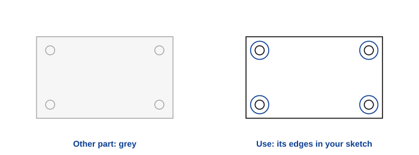

# Use

Projects edges of other parts into your sketch, linked.

**Where:** In a sketch → **Use** (++u++).

## When to use

A part that must match another: standoffs on the holes of a base plate. Move a hole, the sketch follows.

## Main options

| Select | You get |
|---|---|
| An edge | That edge in the sketch |
| A face | All its edges |
| Then **Offset** | A gap around a part: a clearance channel |

## Picture

## Common mistakes

- **Copying the size by hand instead.** Typed numbers do not follow when the other part changes.
- **Use edge deleted later.** The sketch shows an error; edit it and pick the edge again.

## Used in

- [Lesson 3 · Where to sketch](../../lesson-3.md#3-where-to-sketch)
- [L3-6](../../lesson-3.md#l36)
- [L3-8](../../lesson-3.md#l38)

[Use](https://cad.onshape.com/help/Content/sketch-tools-use.htm){target=_blank}
