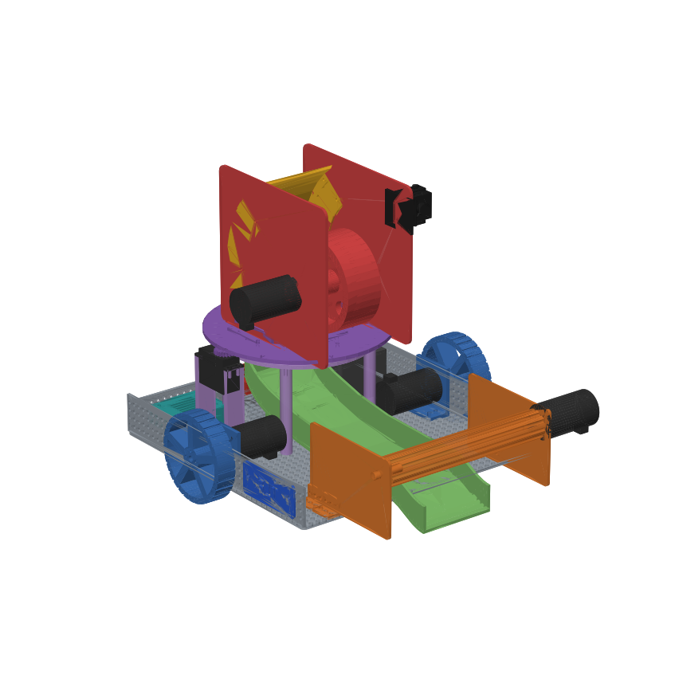
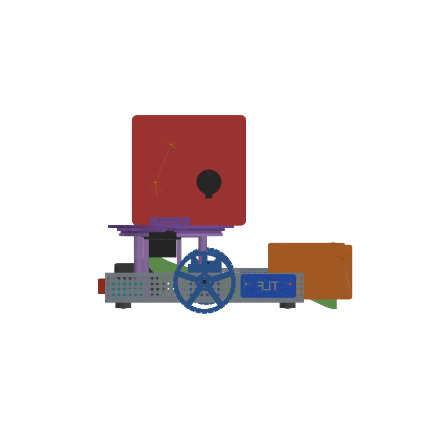
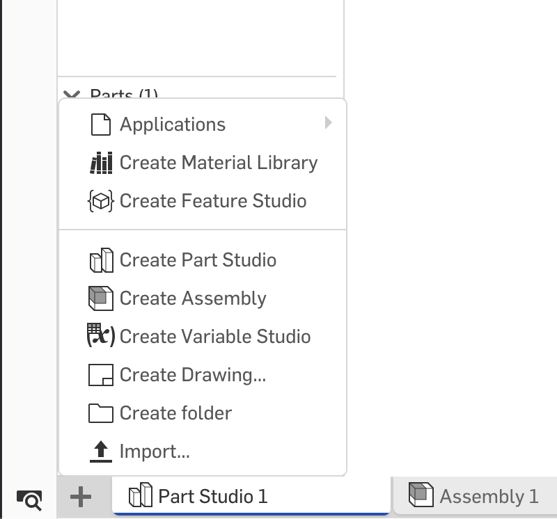
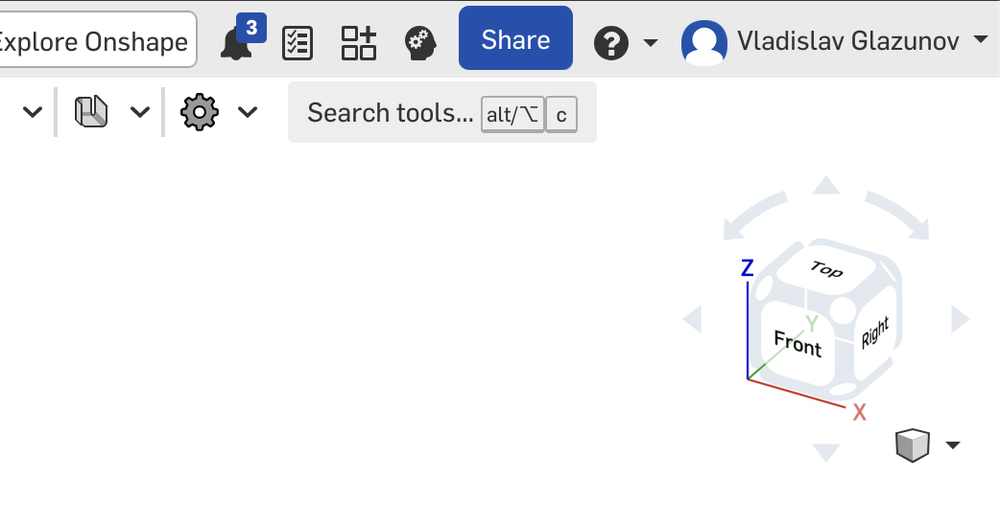

# Team robot

Every student builds one subassembly of about 5 parts. Together they make a small shooter robot: the intake roller pushes a ball (Ø70) up the curved track, the ball rises through the middle of the turret and the flywheel throws it out along the hood.

{width=49%} {width=49%}

{width=70%}

!!! warning "Read this first"
    This robot is a **training example**. It is not connected to FTC and does not follow FTC rules — it only has a similar structure (drive, intake, turret, shooter).

## How to work in Onshape

1. **Each of you makes your own Onshape document** for your subassembly. Name it `Name_SimpleRobot_Subassembly`, for example `Vlad_SimpleRobot_Intake`.
2. **Every part gets its own Part Studio.** Click **+** at the bottom left → **Create Part Studio**. Rename the tab with the part number and name, for example `4.3 Intake roller`.

    {width=45%}

3. When all parts are ready, click **+** → **Create Assembly**, insert your parts and put them together as on the assembly sheet of your subassembly.
4. **Share the document with Vlad.** Click **Share** at the top right.

    {width=45%}

    On the **Individuals** tab type `vglazunov@isl.cy`, choose **Can edit**, tick **Copy**, **Link document**, **Export** and **Comment**, then click **Share**. **Link document** is required — without it I cannot insert your assembly into the robot.

    {width=60%}

5. **Send me the link.** Open your document, copy the address from the browser address bar (it starts with `https://cad.onshape.com/documents/`), paste it into the field below and press **Save**. You can change it later.

## Coordinates

All parts are placed in one robot coordinate system: **X** forward, **Y** left, **Z** up, origin in the middle of the base plate on the floor. Base grid: holes Ø4, pitch 8, plates 3 thick.

## Subassemblies

| # | Subassembly | Student | Parts |
|---|---|---|---|
| 1 | [Chassis](sub-1.md) | Mirzo | 4 |
| 2 | [Drive module ×2](sub-2.md) | Luchezar | 4 |
| 3 | [Ball casters](sub-3.md) | Leonid | 3 |
| 4 | [Intake](sub-4.md) | Malika | 6 |
| 5 | [Ball track](sub-5.md) | Nikita | 5 |
| 6 | [Turret base](sub-6.md) | Alexey | 4 |
| 7 | [Turret gears](sub-7.md) | Fedor | 3 |
| 8 | [Turret platform](sub-8.md) | Egor | 3 |
| 9 | [Shooter](sub-9.md) | Andrey | 6 |
| 10 | [Hood](sub-10.md) | Mansur | 2 |
| 11 | [Battery box](sub-11.md) | Gulasal | 4 |
| 12 | [Control hub housing](sub-12.md) | Elias | 3 |
| 13 | [Camera mount](sub-13.md) | Jason | 4 |
| 14 | [Number plates](sub-14.md) | Arina | 1 |
| 15 | [Power switch](sub-15.md) | Alexandros | 3 |

!!! note "Standard motor and servo"
    Every motor on the robot (drive, intake, shooter) is the same simplified model: [2.1](sub-2.md#p2-1). The servo: [6.4](sub-6.md#p6-4). Each student models his own copy from that drawing.
