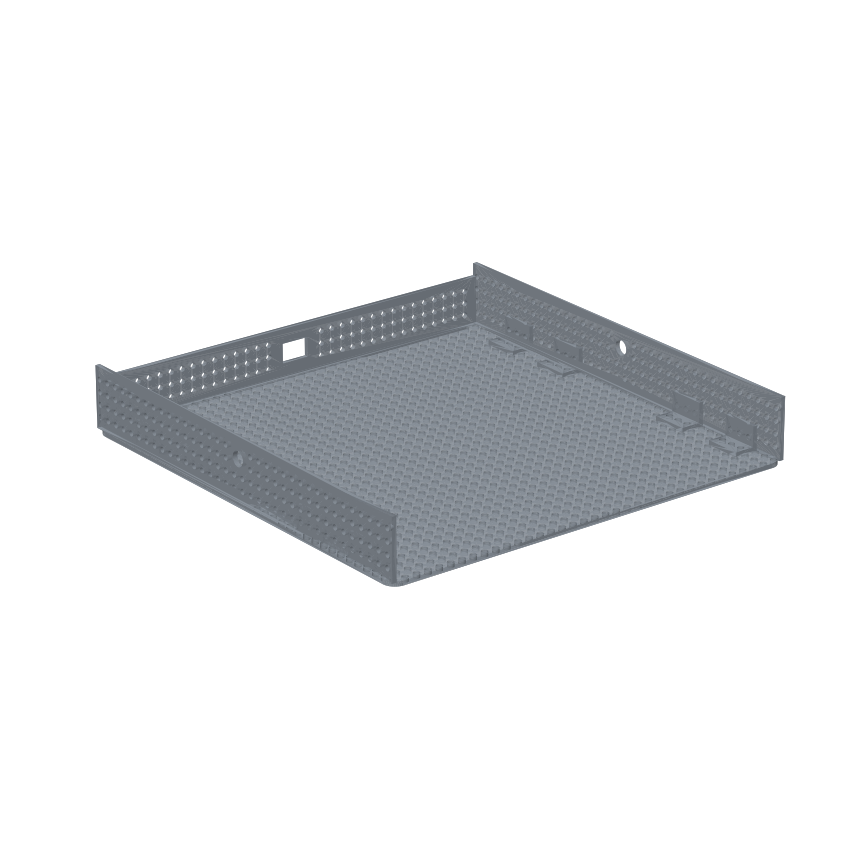
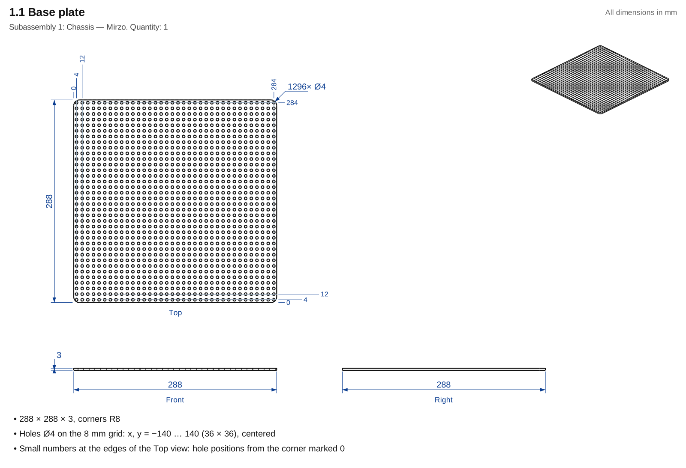
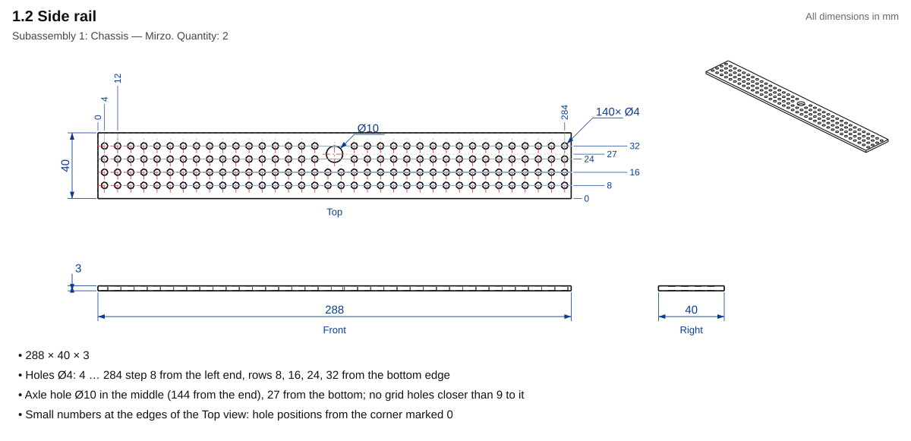
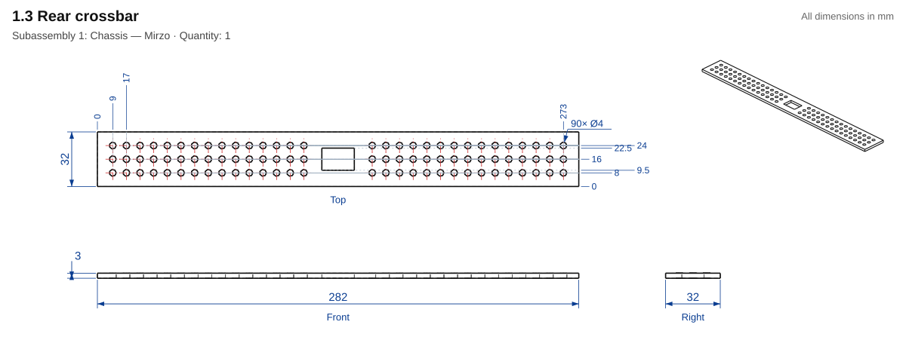
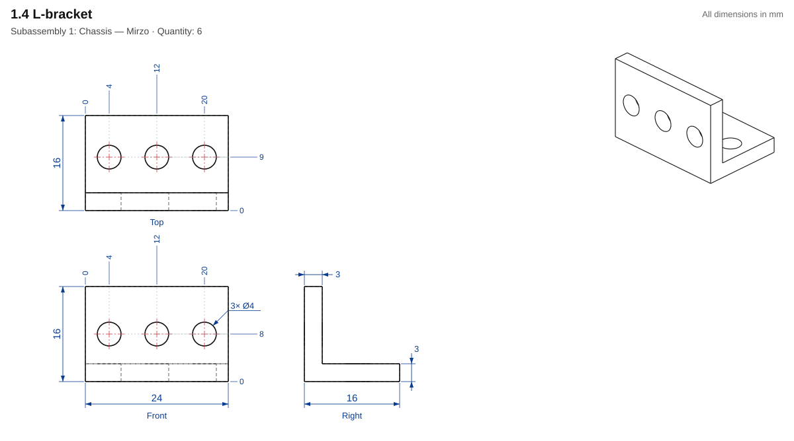

# 1. Chassis

**Student:** Mirzo

{width=60%}

| Part | Name | Qty |
|---|---|---|
| [1.1](#p1-1) | Base plate | 1 |
| [1.2](#p1-2) | Side rail | 2 |
| [1.3](#p1-3) | Rear crossbar | 1 |
| [1.4](#p1-4) | L-bracket | 8 |

## 1.1 Base plate {#p1-1}

## 1.2 Side rail {#p1-2}

## 1.3 Rear crossbar {#p1-3}

## 1.4 L-bracket {#p1-4}

