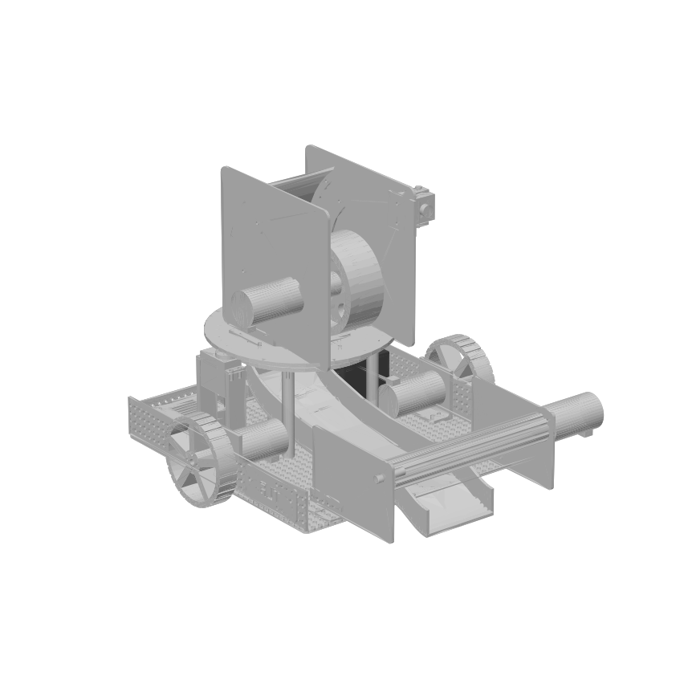
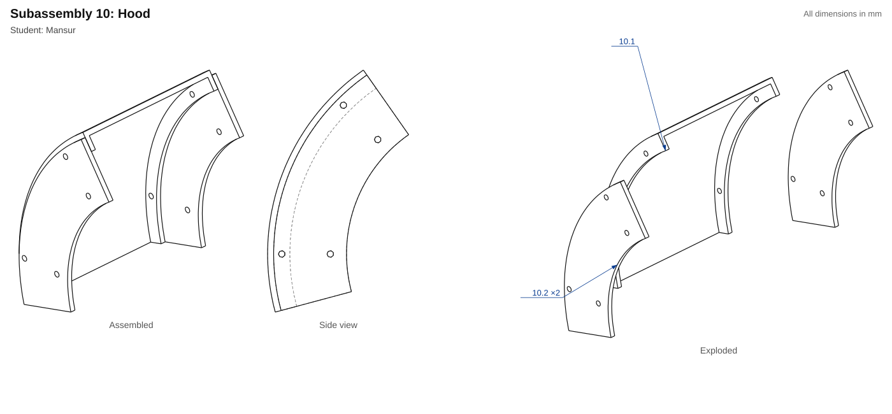
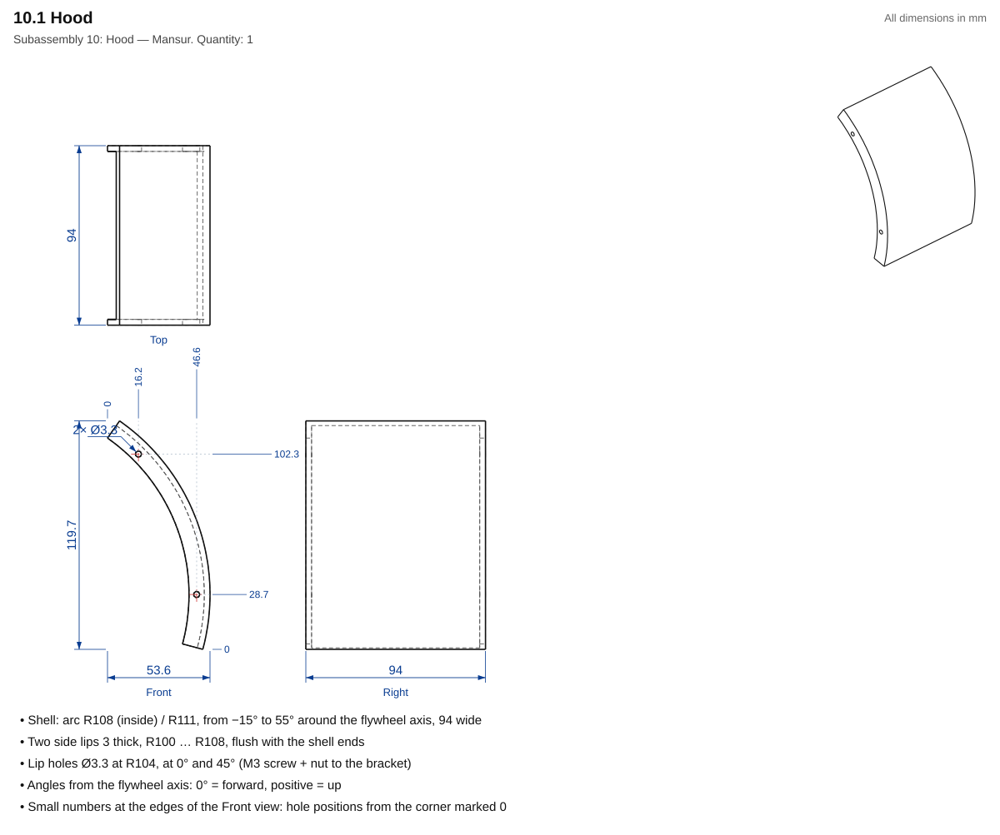
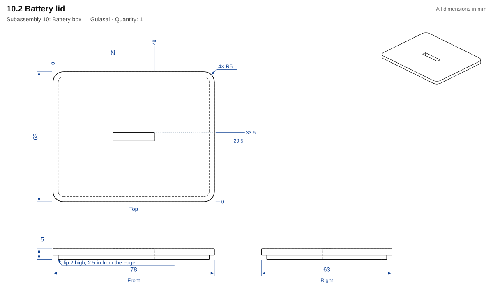
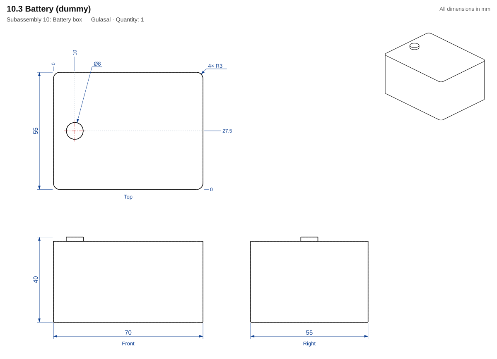
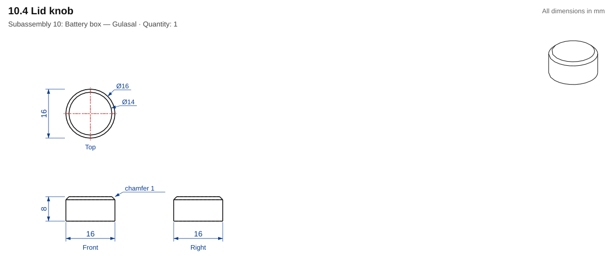

# 10. Battery box

**Student:** Gulasal

## Where it goes

{width=60%}

## Assembly

## Parts

| Part | Name | Qty |
|---|---|---|
| [10.1](#p10-1) | Battery tray | 1 |
| [10.2](#p10-2) | Battery lid | 1 |
| [10.3](#p10-3) | Battery (dummy) | 1 |
| [10.4](#p10-4) | Lid knob | 1 |

### 10.1 Battery tray {#p10-1}

### 10.2 Battery lid {#p10-2}

### 10.3 Battery (dummy) {#p10-3}

### 10.4 Lid knob {#p10-4}

