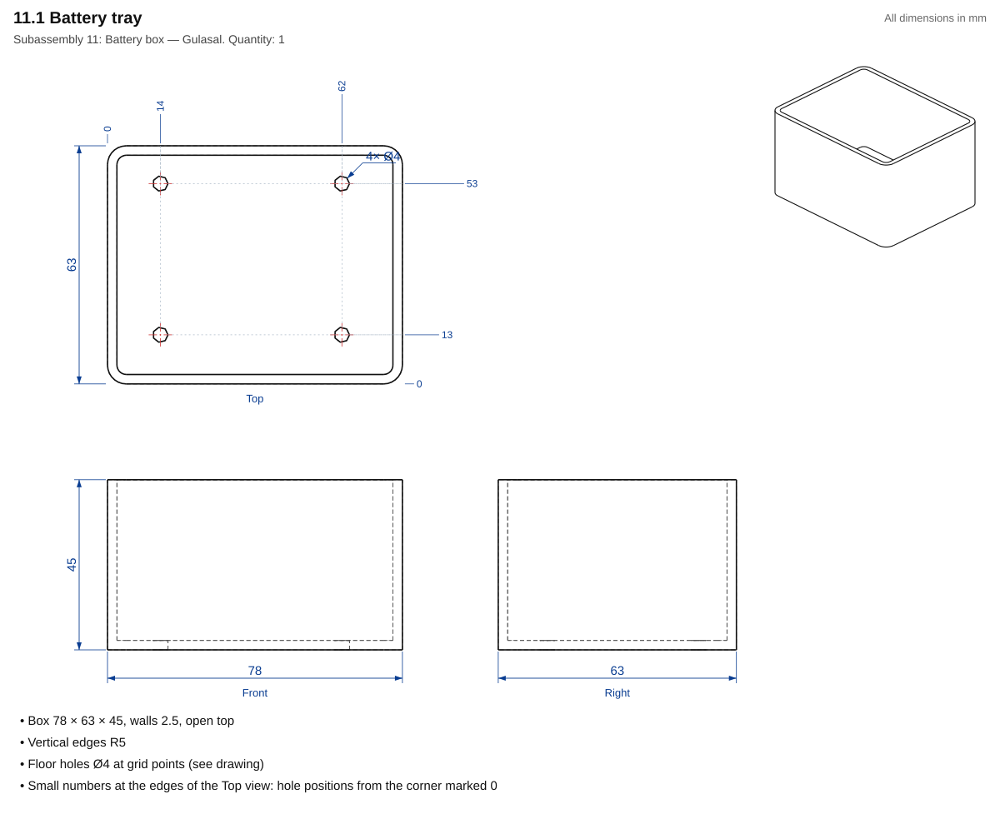
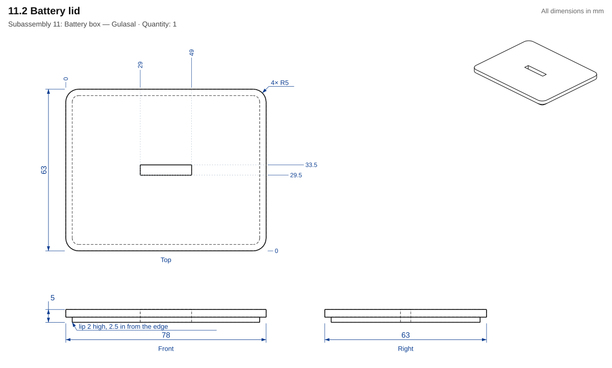

# 11. Control hub housing

**Student:** Elias

## Where it goes

{width=60%}

## Assembly

## Parts

| Part | Name | Qty |
|---|---|---|
| [11.1](#p11-1) | Hub tray | 1 |
| [11.2](#p11-2) | Hub cover | 1 |
| [11.3](#p11-3) | Control hub board | 1 |

### 11.1 Hub tray {#p11-1}

### 11.2 Hub cover {#p11-2}

### 11.3 Control hub board {#p11-3}

