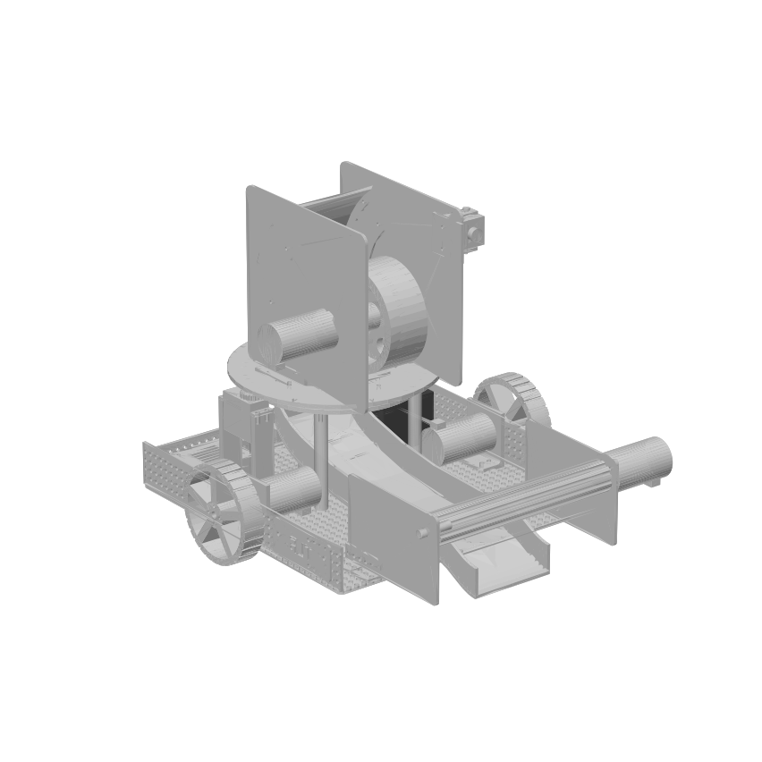
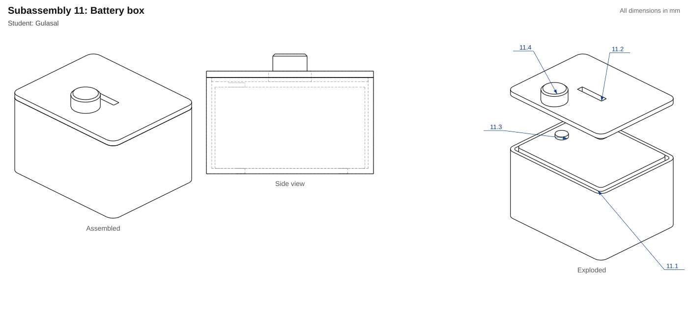
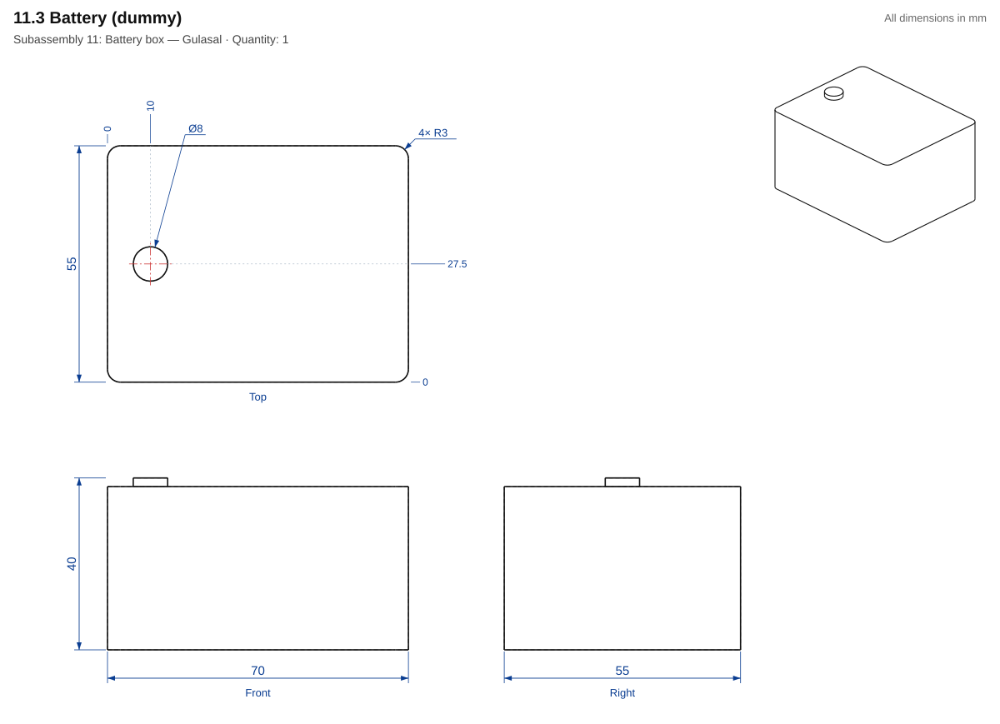
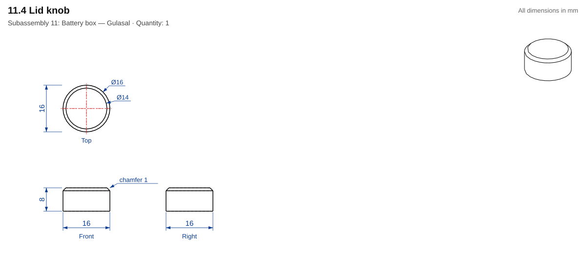

# 11. Battery box

**Student:** Gulasal

## Where it goes

{width=60%}

## Assembly

## Parts

| Part | Name | Qty |
|---|---|---|
| [11.1](#p11-1) | Battery tray | 1 |
| [11.2](#p11-2) | Battery lid | 1 |
| [11.3](#p11-3) | Battery (dummy) | 1 |
| [11.4](#p11-4) | Lid knob | 1 |

### 11.1 Battery tray {#p11-1}

### 11.2 Battery lid {#p11-2}

### 11.3 Battery (dummy) {#p11-3}

### 11.4 Lid knob {#p11-4}

