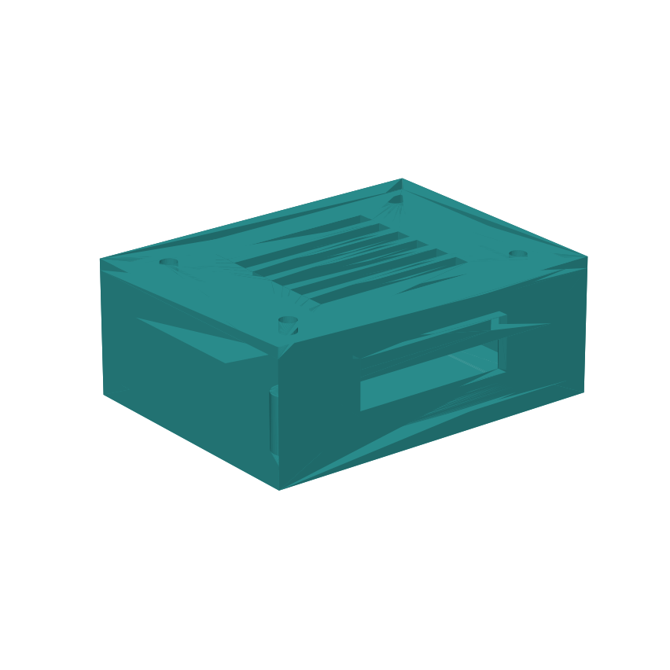
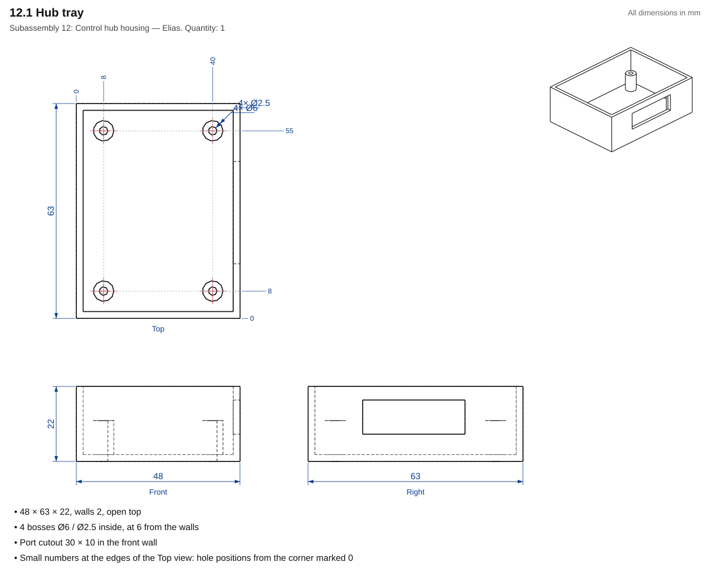
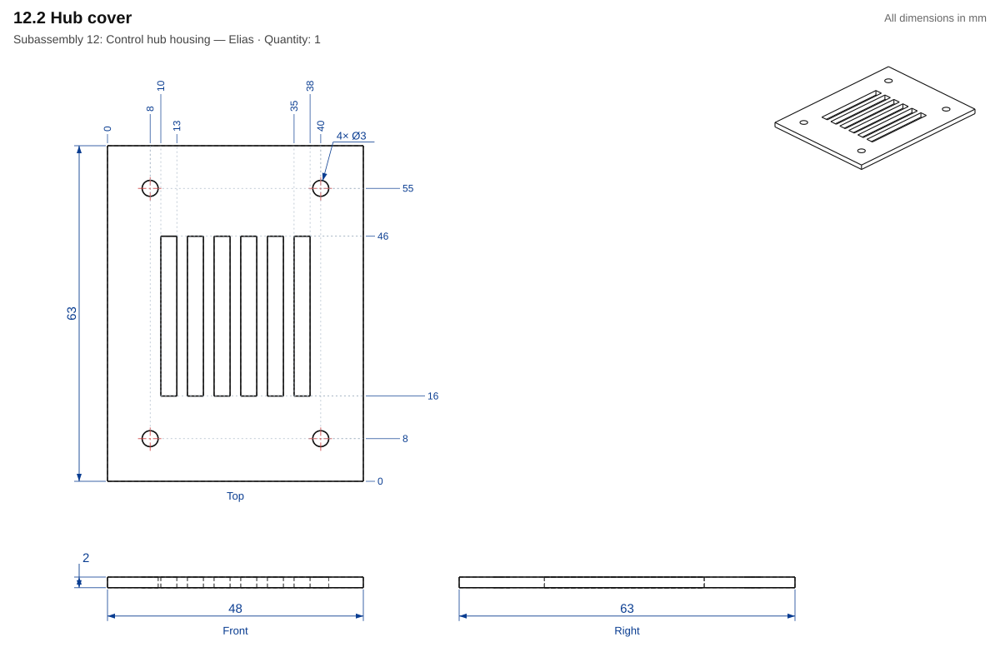

# 12. Control hub housing

**Student:** Elias

{width=60%}

| Part | Name | Qty |
|---|---|---|
| [12.1](#p12-1) | Hub tray | 1 |
| [12.2](#p12-2) | Hub cover | 1 |
| [12.3](#p12-3) | Control hub board | 1 |

## 12.1 Hub tray {#p12-1}

## 12.2 Hub cover {#p12-2}

## 12.3 Control hub board {#p12-3}

