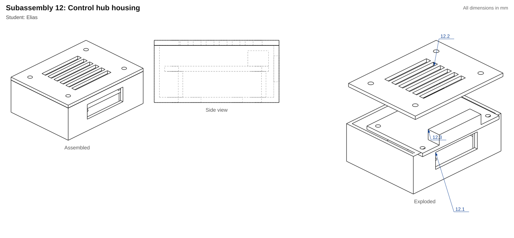
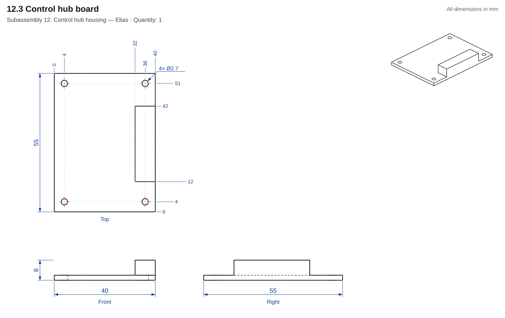
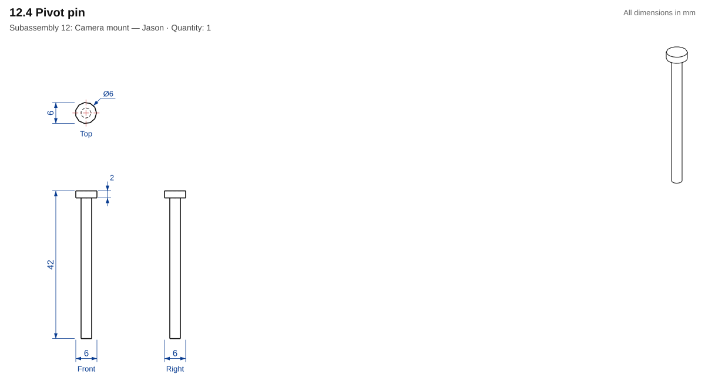

# 12. Camera mount

**Student:** Jason

## Where it goes

{width=60%}

## Assembly

## Parts

| Part | Name | Qty |
|---|---|---|
| [12.1](#p12-1) | Camera base | 1 |
| [12.2](#p12-2) | Camera fork | 1 |
| [12.3](#p12-3) | Camera body | 1 |
| [12.4](#p12-4) | Pivot pin | 1 |

### 12.1 Camera base {#p12-1}

### 12.2 Camera fork {#p12-2}

### 12.3 Camera body {#p12-3}

### 12.4 Pivot pin {#p12-4}

