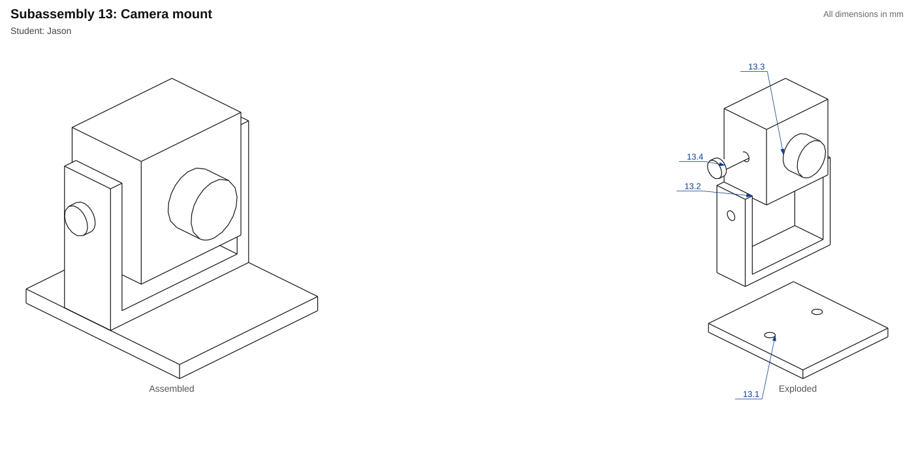
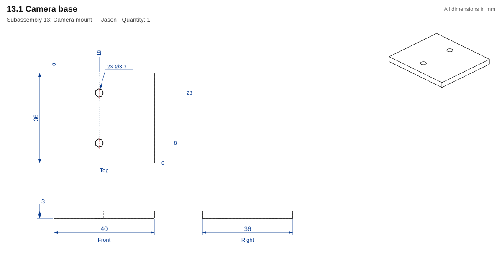

# 13. Number plates

**Student:** Arina

## Where it goes

{width=60%}

## Assembly

## Parts

| Part | Name | Qty |
|---|---|---|
| [13.1](#p13-1) | Number plate | 2 |

### 13.1 Number plate {#p13-1}

