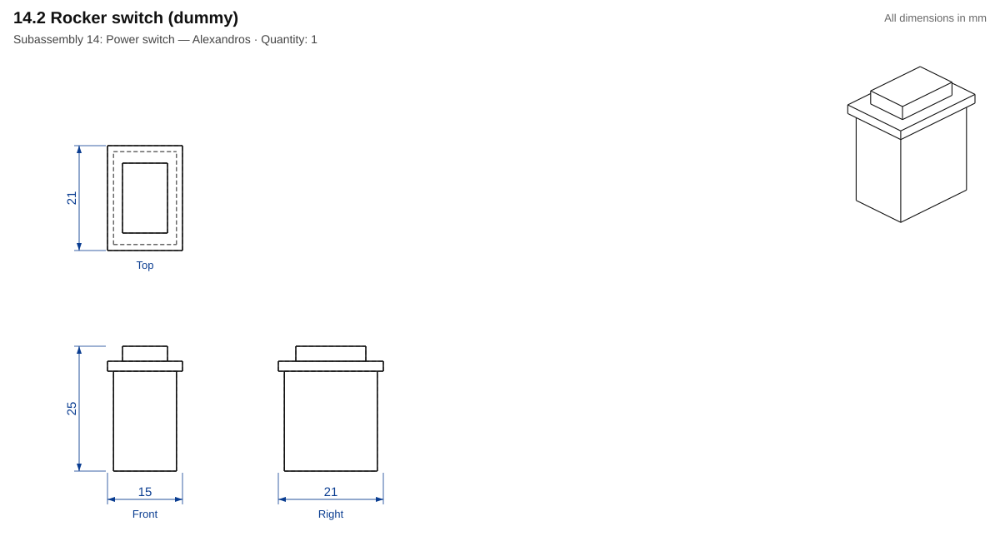
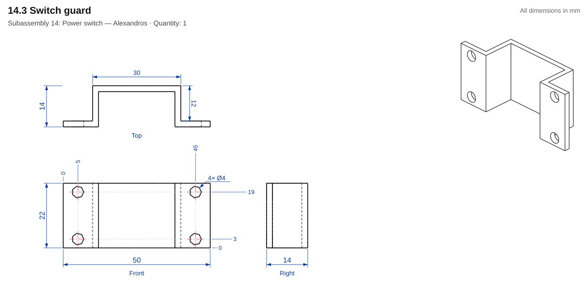

# 14. Power switch

**Student:** Alexandros

## Where it goes

{width=60%}

## Assembly

## Parts

| Part | Name | Qty |
|---|---|---|
| [14.1](#p14-1) | Switch panel | 1 |
| [14.2](#p14-2) | Rocker switch (dummy) | 1 |
| [14.3](#p14-3) | Switch guard | 1 |

### 14.1 Switch panel {#p14-1}

### 14.2 Rocker switch (dummy) {#p14-2}

### 14.3 Switch guard {#p14-3}

