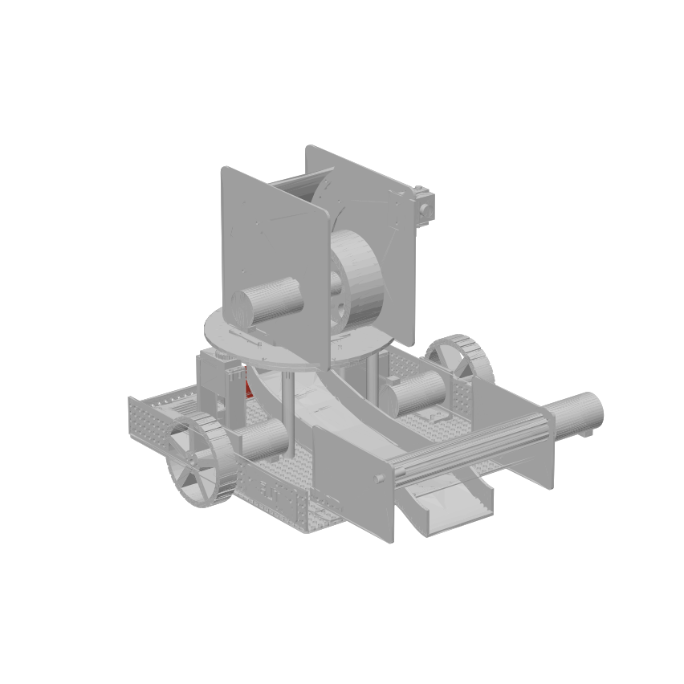
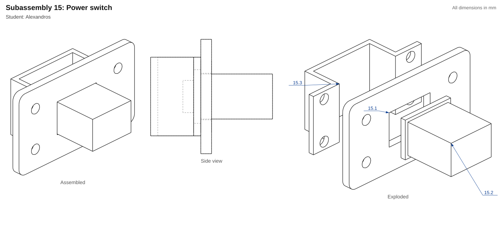
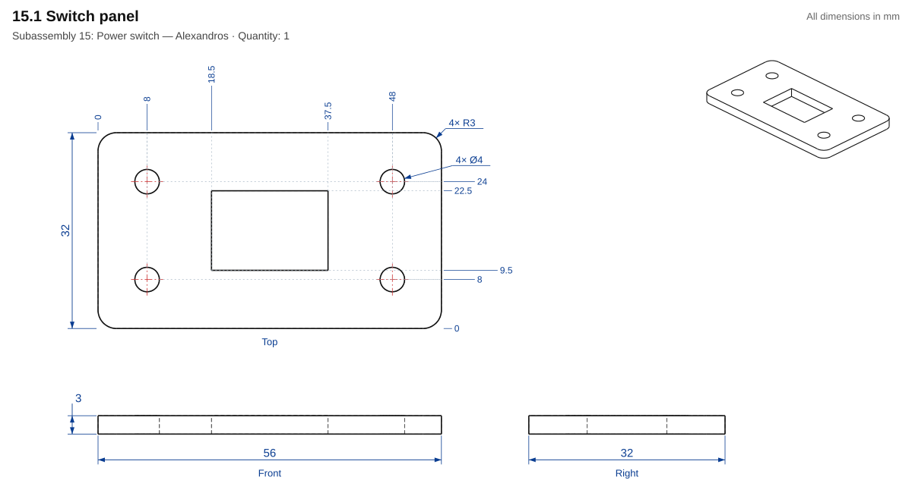
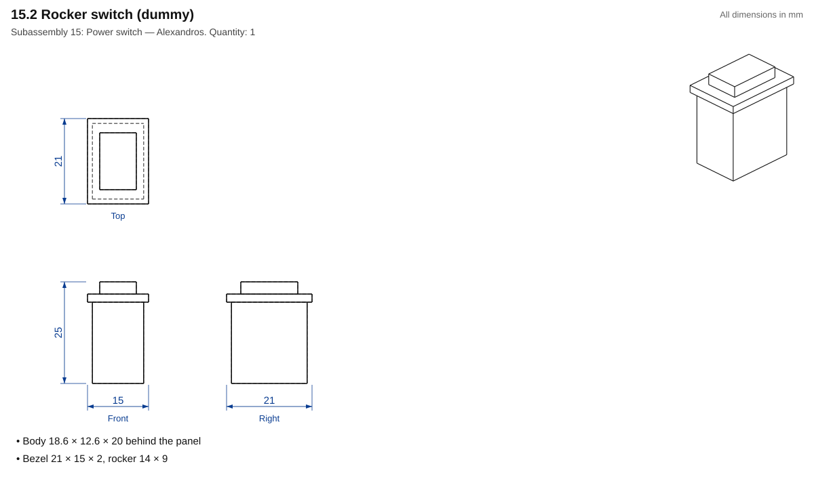
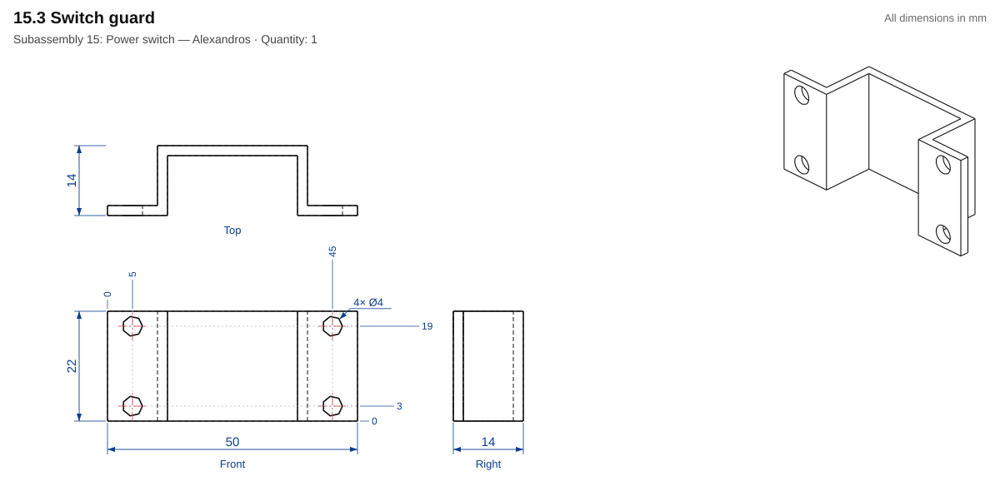

# 15. Power switch

**Student:** Alexandros

## Where it goes

{width=60%}

## Assembly

## Parts

| Part | Name | Qty |
|---|---|---|
| [15.1](#p15-1) | Switch panel | 1 |
| [15.2](#p15-2) | Rocker switch (dummy) | 1 |
| [15.3](#p15-3) | Switch guard | 1 |

### 15.1 Switch panel {#p15-1}

### 15.2 Rocker switch (dummy) {#p15-2}

### 15.3 Switch guard {#p15-3}

