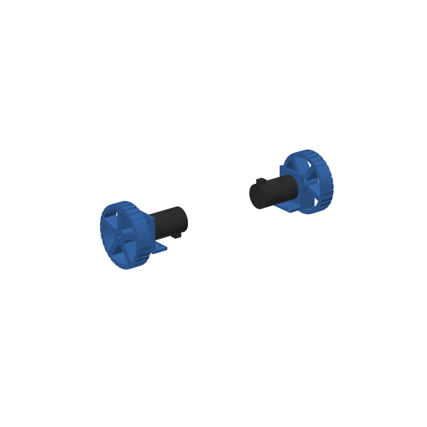
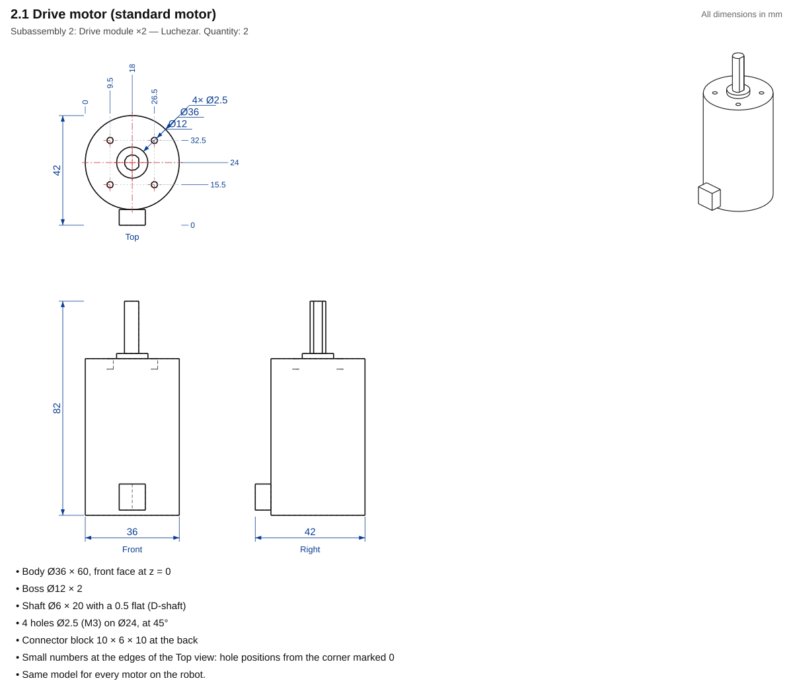
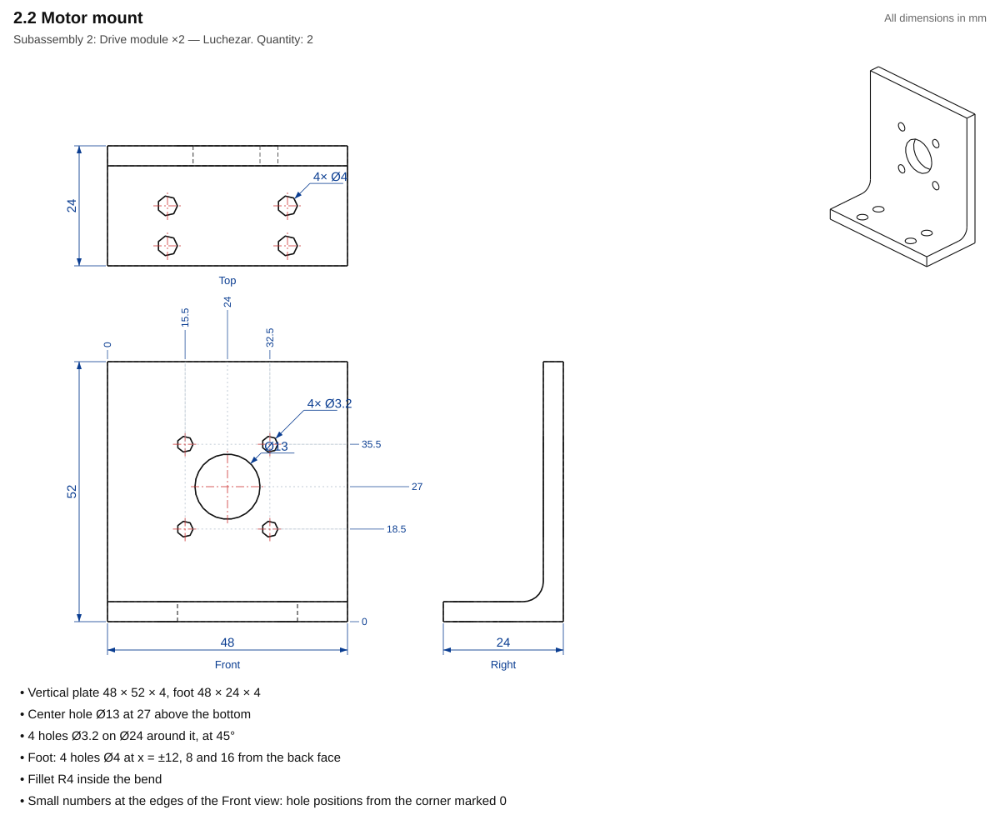
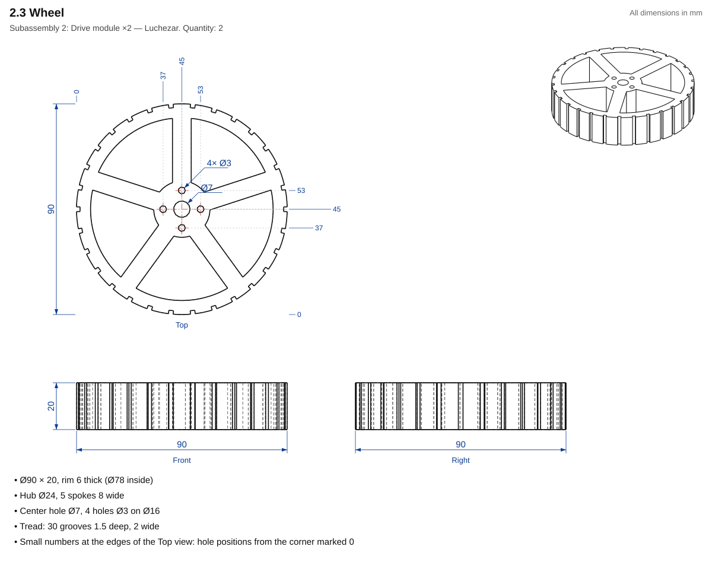
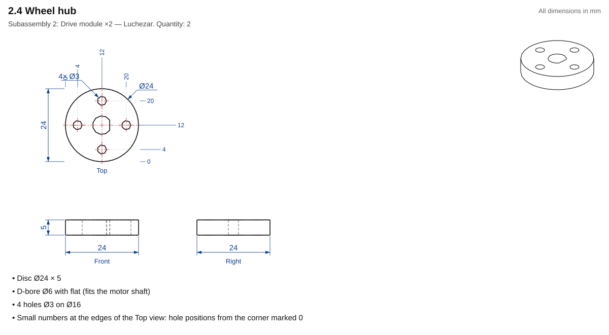

# 2. Drive module ×2

**Student:** Luchezar

{width=60%}

| Part | Name | Qty |
|---|---|---|
| [2.1](#p2-1) | Drive motor (standard motor) | 2 |
| [2.2](#p2-2) | Motor mount | 2 |
| [2.3](#p2-3) | Wheel | 2 |
| [2.4](#p2-4) | Wheel hub | 2 |

## 2.1 Drive motor (standard motor) {#p2-1}

## 2.2 Motor mount {#p2-2}

## 2.3 Wheel {#p2-3}

## 2.4 Wheel hub {#p2-4}

