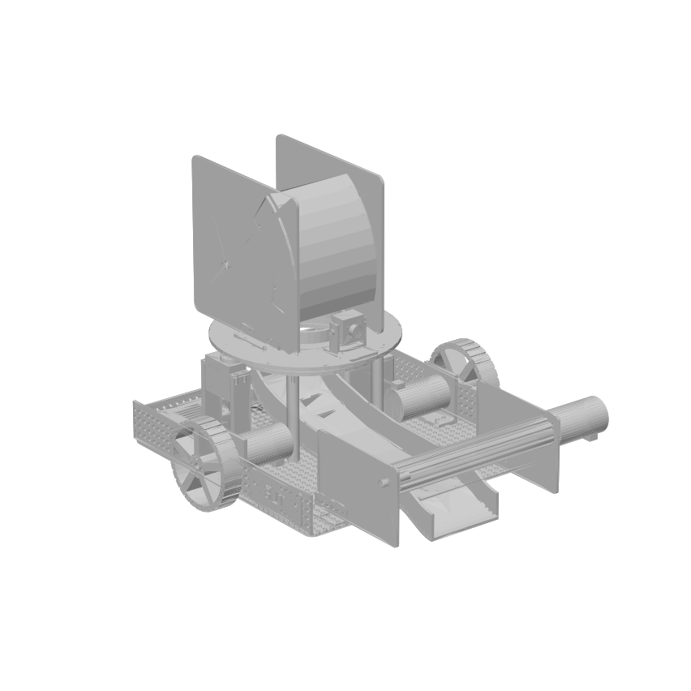
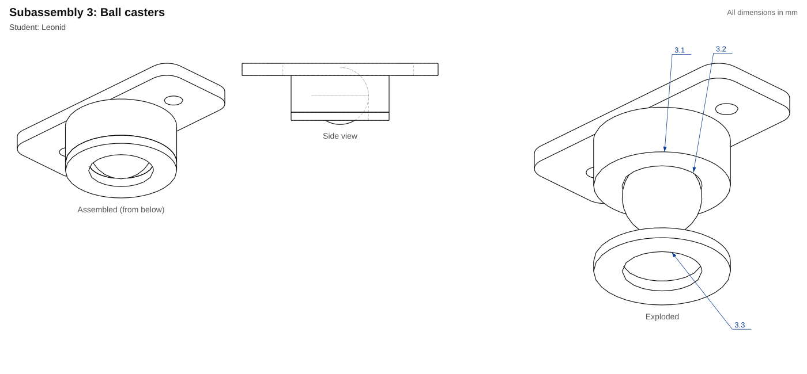
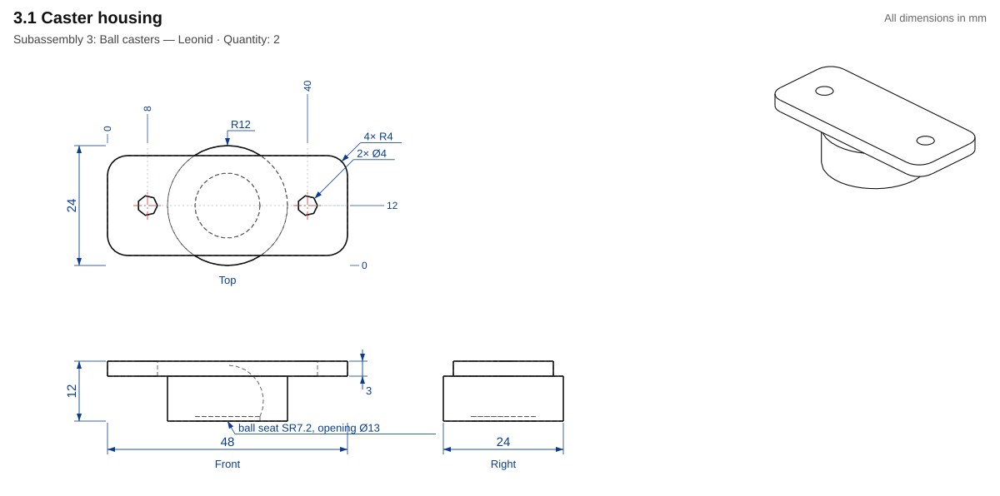
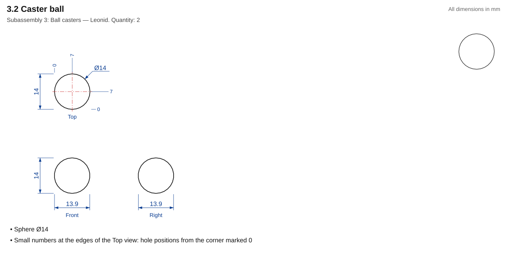
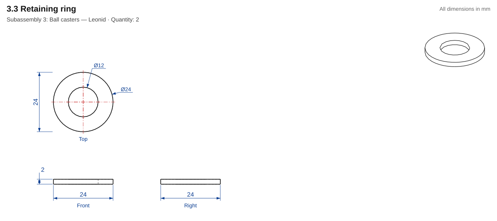

# 3. Ball casters

**Student:** Leonid

## Where it goes

{width=60%}

## Assembly

## Parts

| Part | Name | Qty |
|---|---|---|
| [3.1](#p3-1) | Caster housing | 2 |
| [3.2](#p3-2) | Caster ball | 2 |
| [3.3](#p3-3) | Retaining ring | 2 |

### 3.1 Caster housing {#p3-1}

### 3.2 Caster ball {#p3-2}

### 3.3 Retaining ring {#p3-3}

