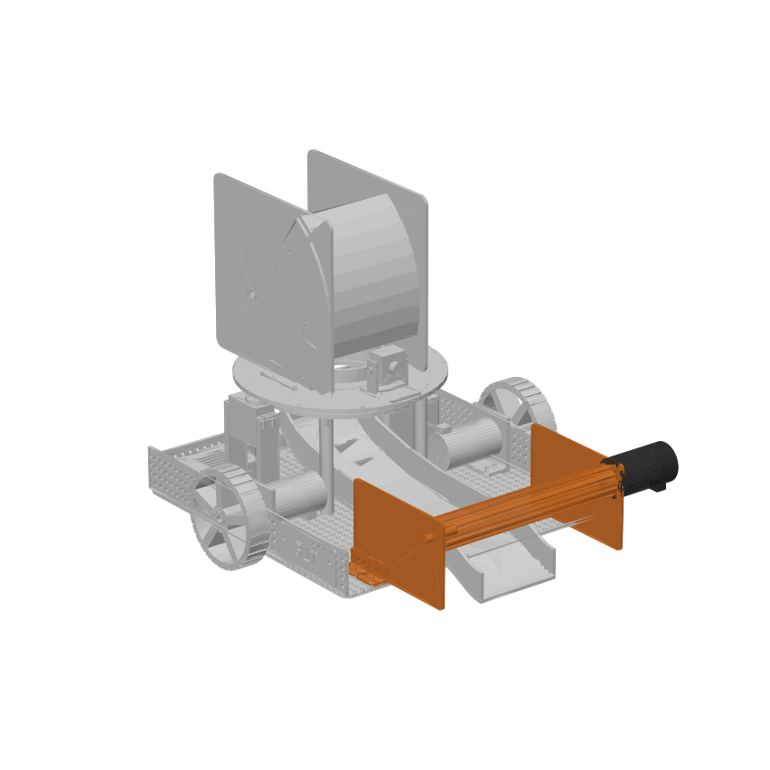
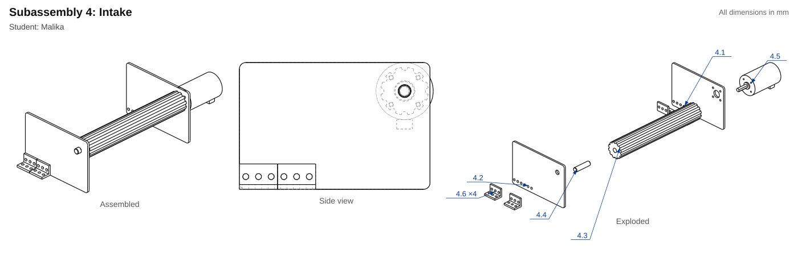
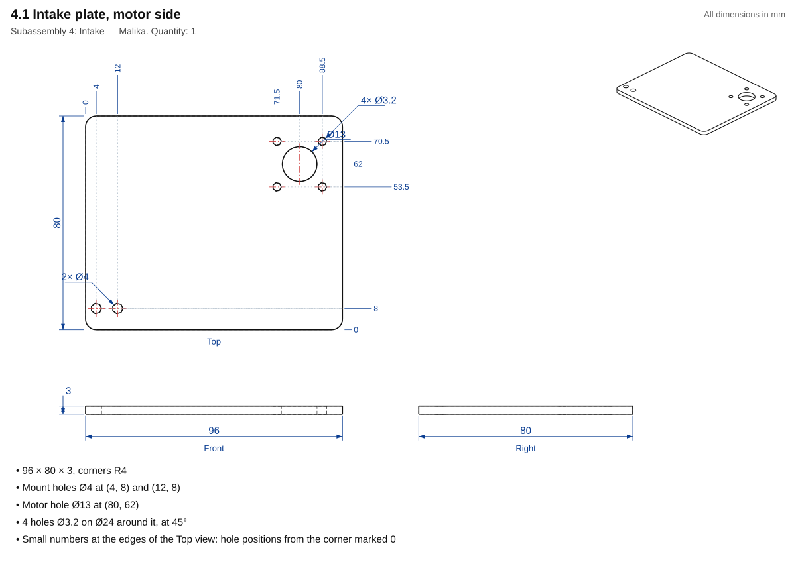
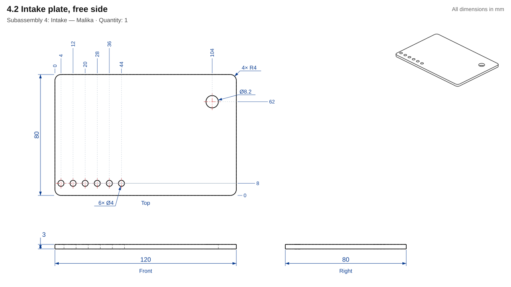
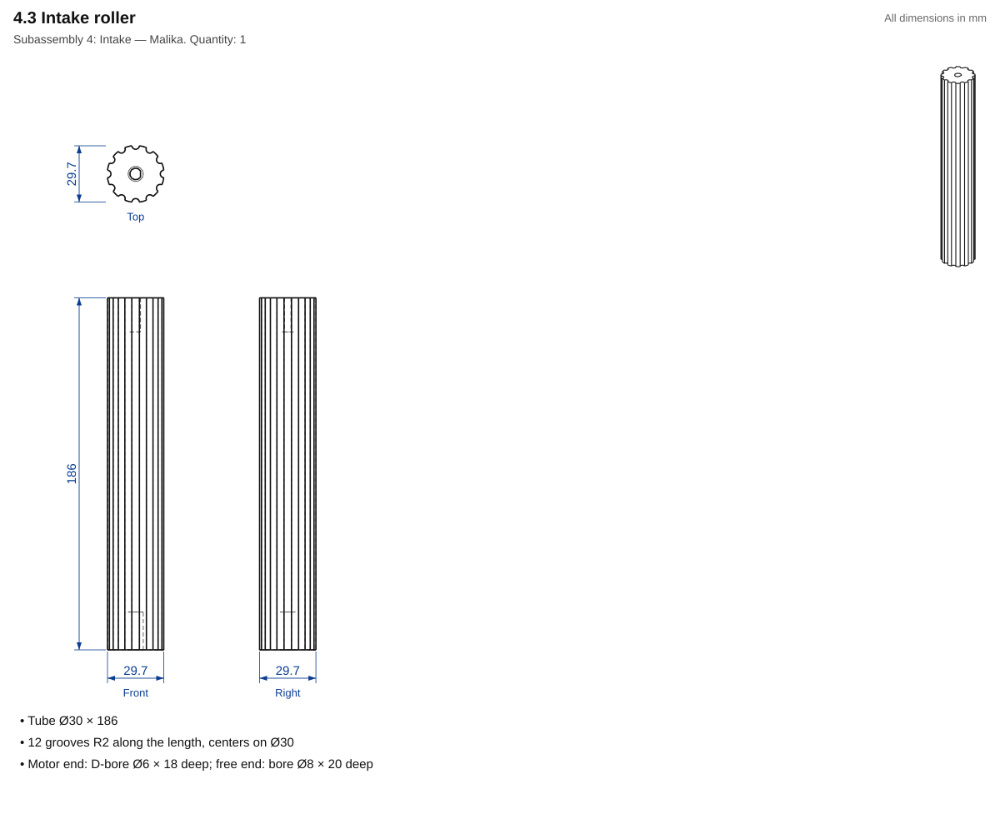
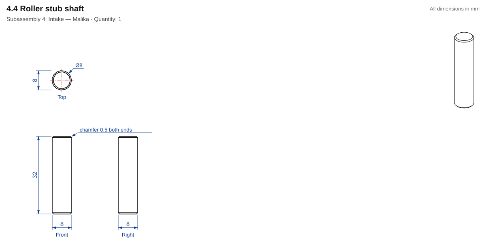
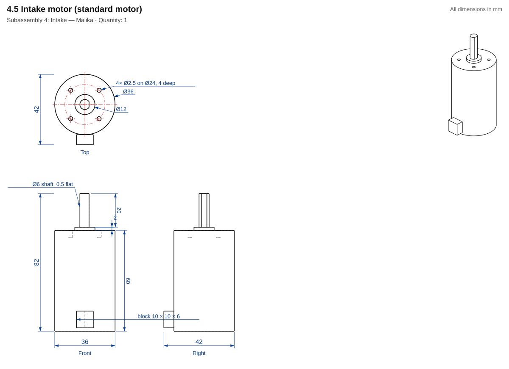
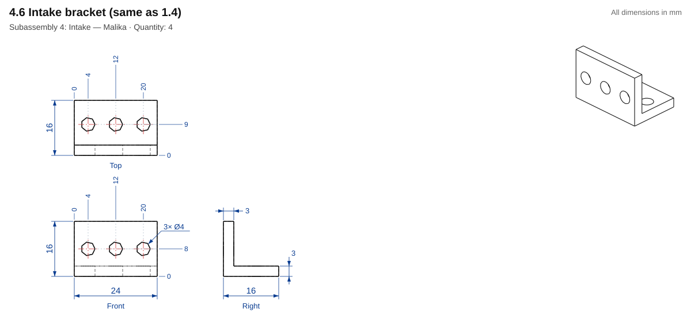

# 4. Intake

**Student:** Malika

## Where it goes

{width=60%}

## Assembly

## Parts

| Part | Name | Qty |
|---|---|---|
| [4.1](#p4-1) | Intake plate, motor side | 1 |
| [4.2](#p4-2) | Intake plate, free side | 1 |
| [4.3](#p4-3) | Intake roller | 1 |
| [4.4](#p4-4) | Roller stub shaft | 1 |
| [4.5](#p4-5) | Intake motor (standard motor) | 1 |
| [4.6](#p4-6) | Intake bracket (same as 1.4) | 4 |

### 4.1 Intake plate, motor side {#p4-1}

### 4.2 Intake plate, free side {#p4-2}

### 4.3 Intake roller {#p4-3}

### 4.4 Roller stub shaft {#p4-4}

### 4.5 Intake motor (standard motor) {#p4-5}

### 4.6 Intake bracket (same as 1.4) {#p4-6}

