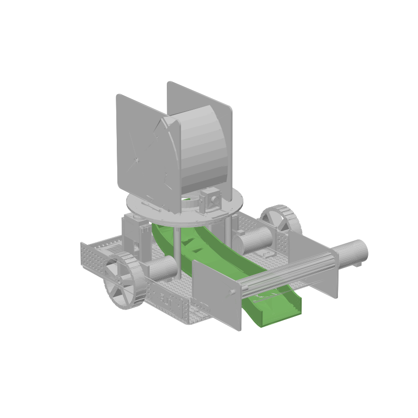
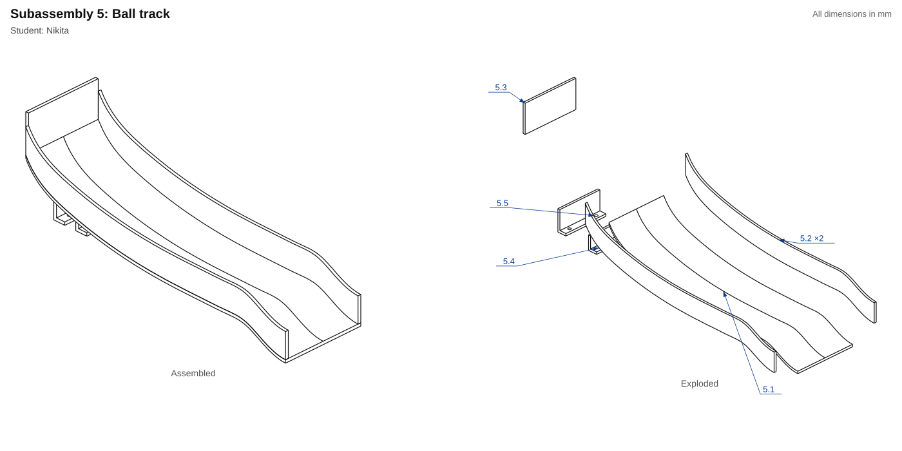
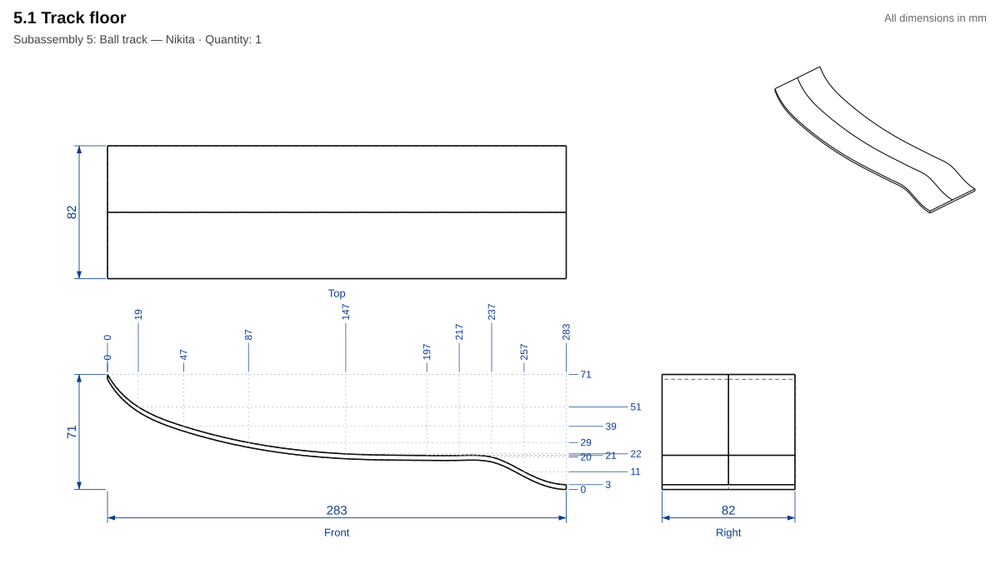
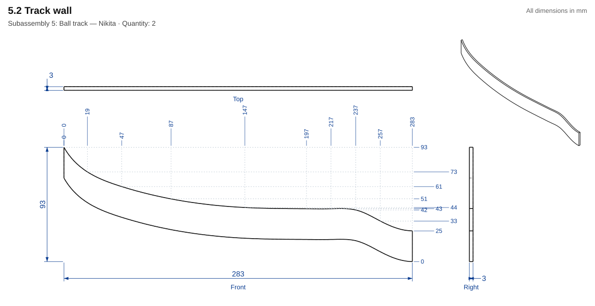
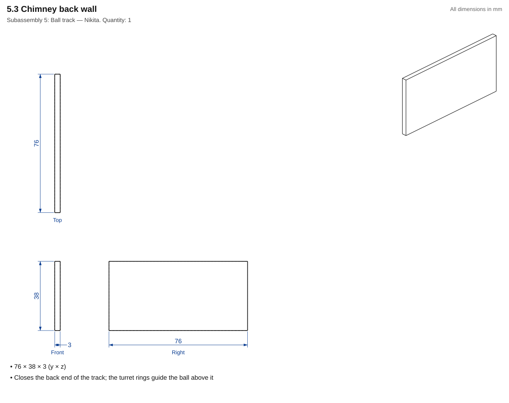
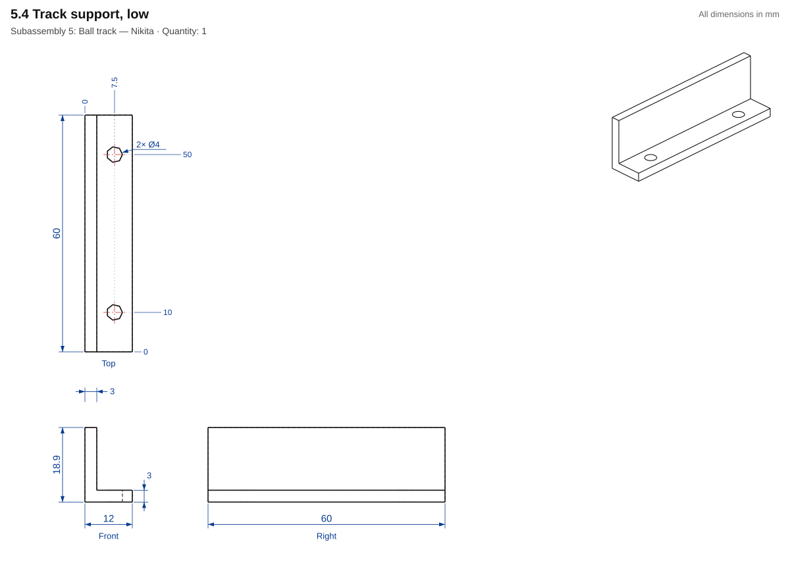
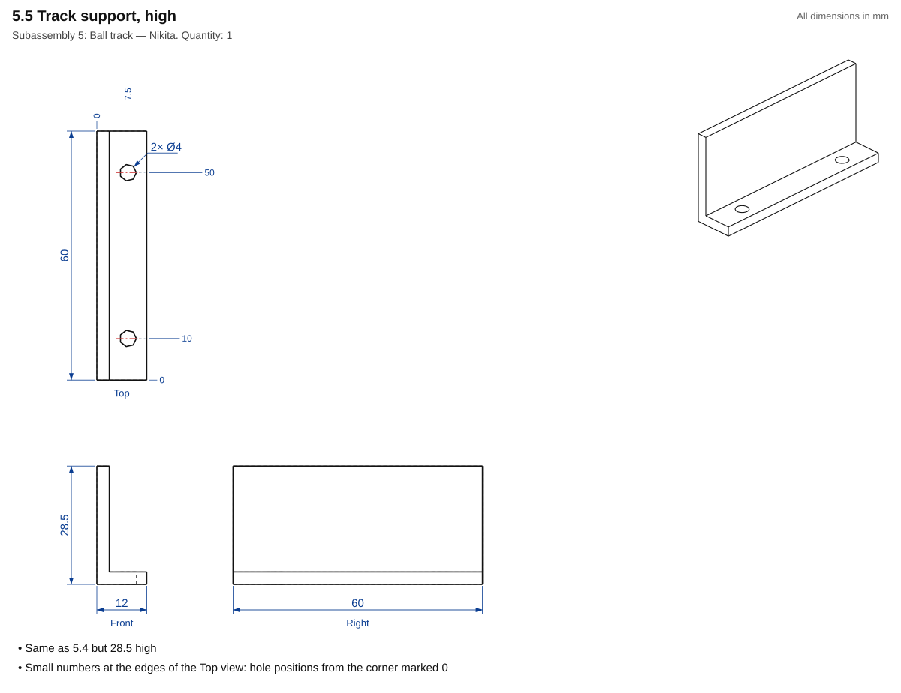

# 5. Ball track

**Student:** Nikita

## Where it goes

{width=60%}

## Assembly

## Parts

| Part | Name | Qty |
|---|---|---|
| [5.1](#p5-1) | Track floor | 1 |
| [5.2](#p5-2) | Track wall | 2 |
| [5.3](#p5-3) | Chimney back wall | 1 |
| [5.4](#p5-4) | Track support, low | 1 |
| [5.5](#p5-5) | Track support, high | 1 |

### 5.1 Track floor {#p5-1}

### 5.2 Track wall {#p5-2}

### 5.3 Chimney back wall {#p5-3}

### 5.4 Track support, low {#p5-4}

### 5.5 Track support, high {#p5-5}

