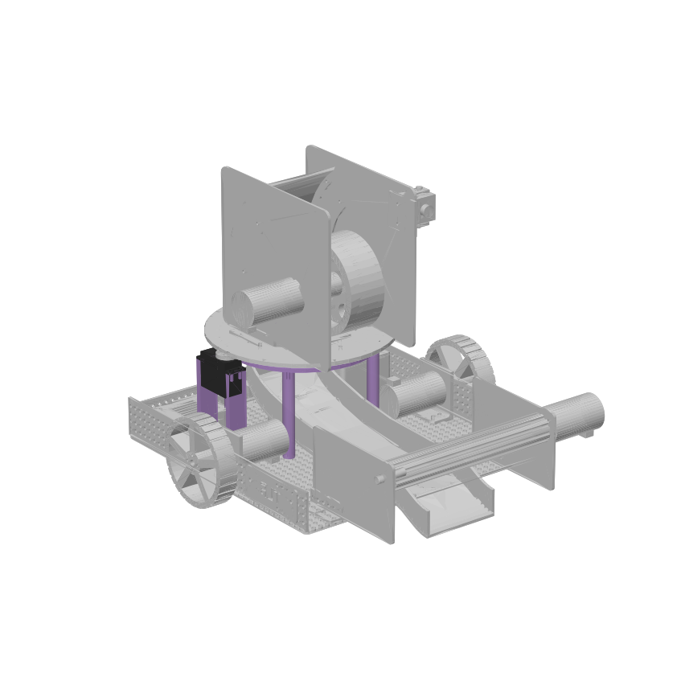
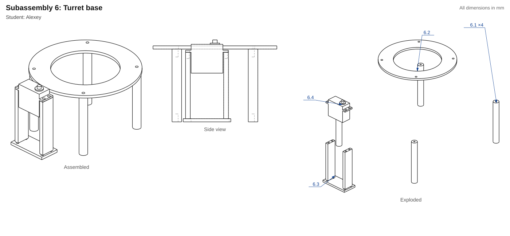
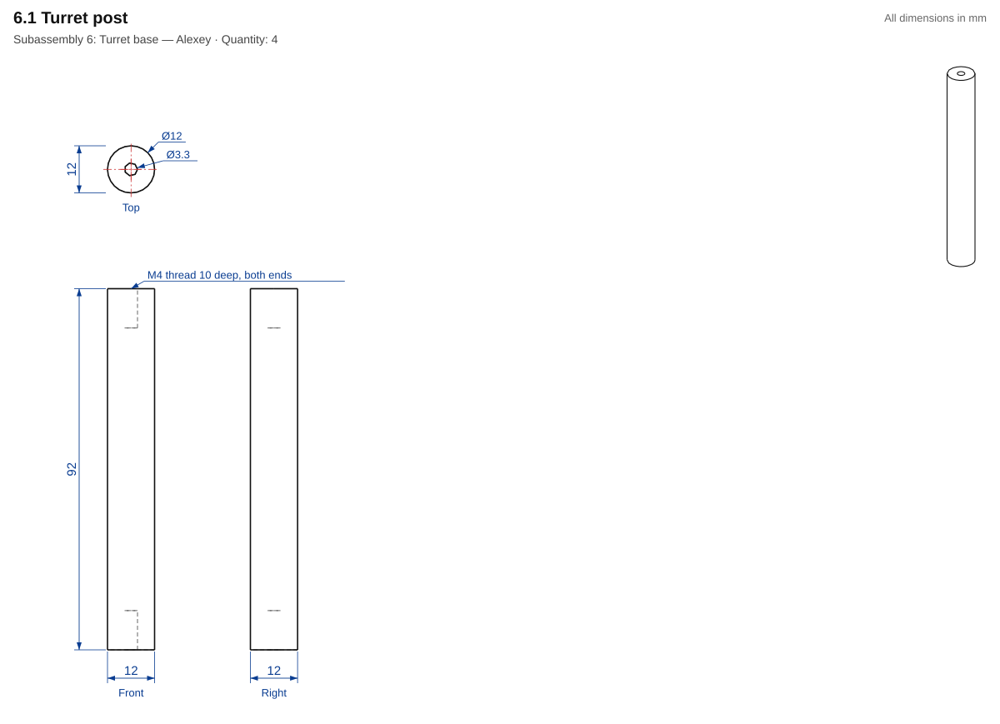
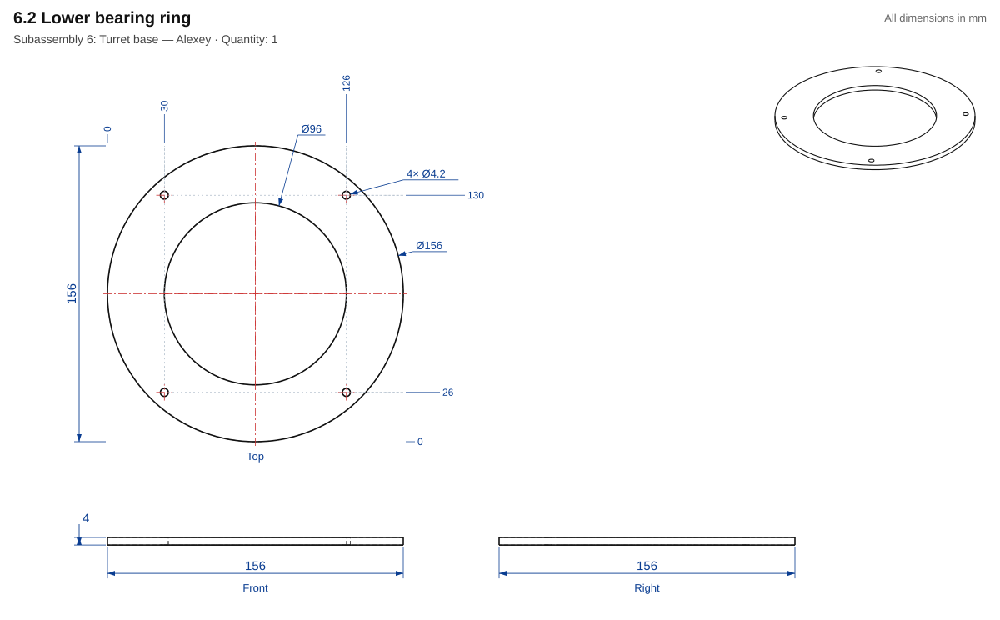
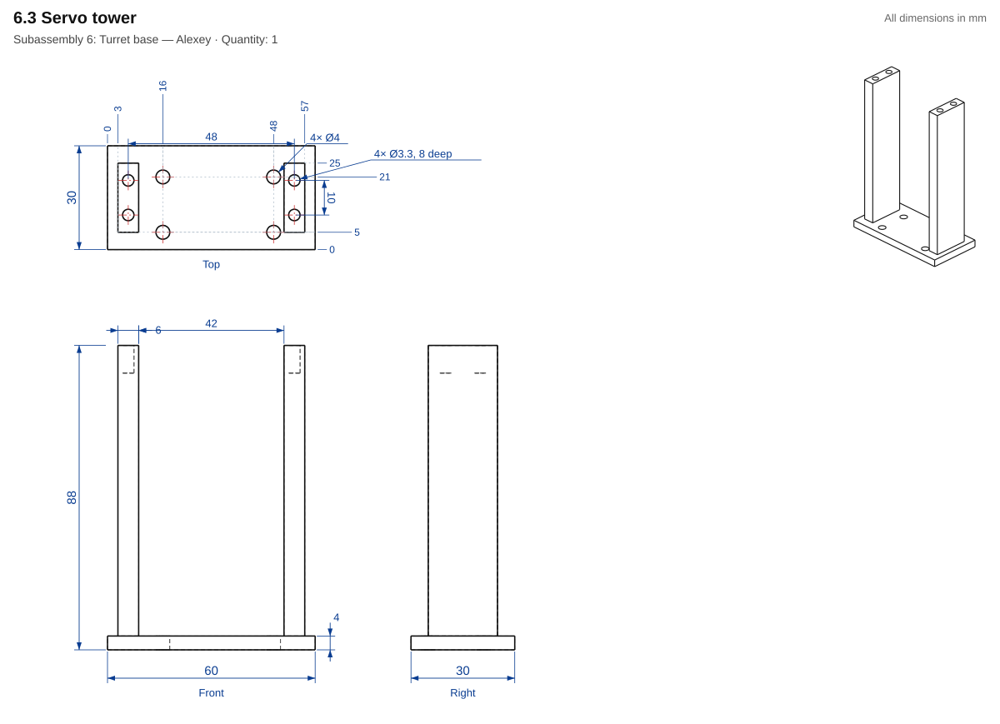
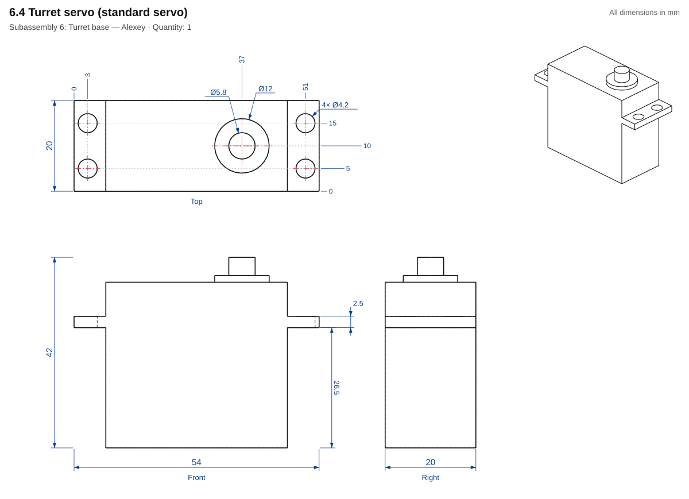

# 6. Turret base

**Student:** Alexey

## Where it goes

{width=60%}

## Assembly

## Parts

| Part | Name | Qty |
|---|---|---|
| [6.1](#p6-1) | Turret post | 4 |
| [6.2](#p6-2) | Lower bearing ring | 1 |
| [6.3](#p6-3) | Servo tower | 1 |
| [6.4](#p6-4) | Turret servo (standard servo) | 1 |

### 6.1 Turret post {#p6-1}

### 6.2 Lower bearing ring {#p6-2}

### 6.3 Servo tower {#p6-3}

### 6.4 Turret servo (standard servo) {#p6-4}

