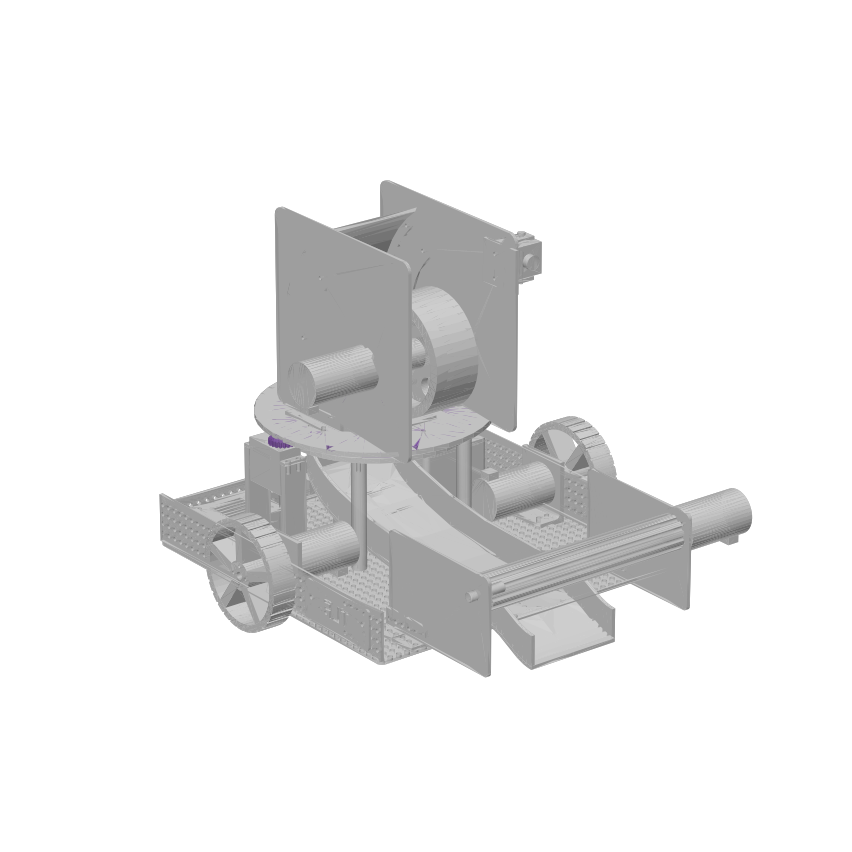
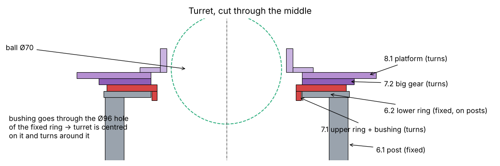
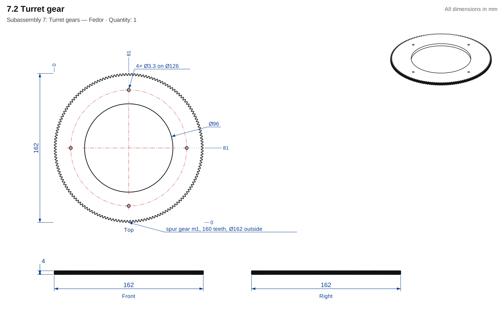
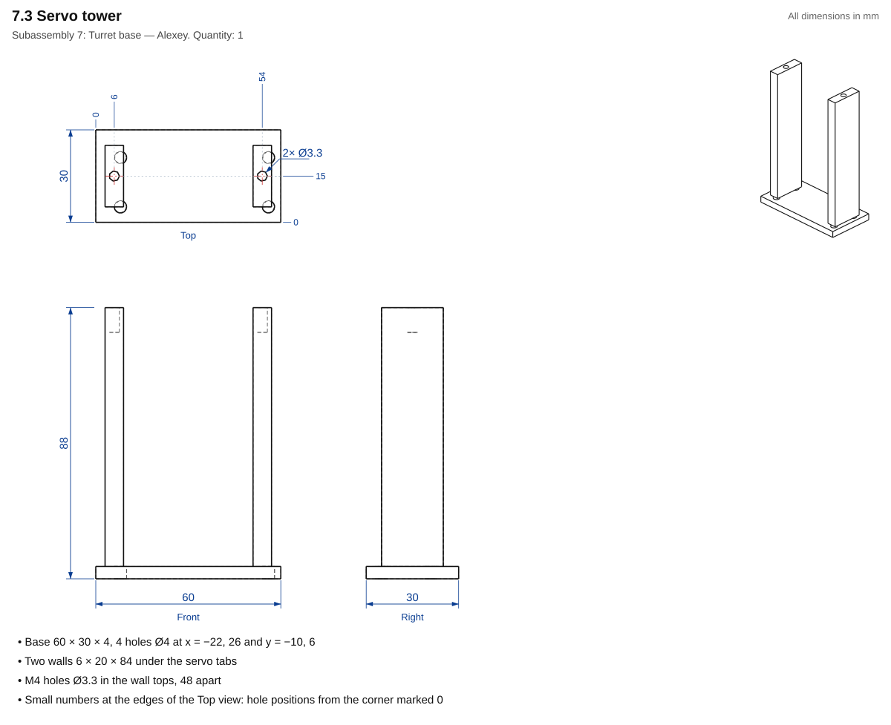

# 7. Turret gears

**Student:** Fedor

## Where it goes

{width=60%}

## Assembly

## How the turret turns

There is no shaft: the ball goes up through the middle. The bushing on 7.1 goes through the Ø96 hole of the fixed ring 6.2, so the turret is centred on it and turns around it.

## Parts

| Part | Name | Qty |
|---|---|---|
| [7.1](#p7-1) | Upper ring with centering bushing | 1 |
| [7.2](#p7-2) | Turret gear | 1 |
| [7.3](#p7-3) | Servo pinion | 1 |

### 7.1 Upper ring with centering bushing {#p7-1}

### 7.2 Turret gear {#p7-2}

### 7.3 Servo pinion {#p7-3}

