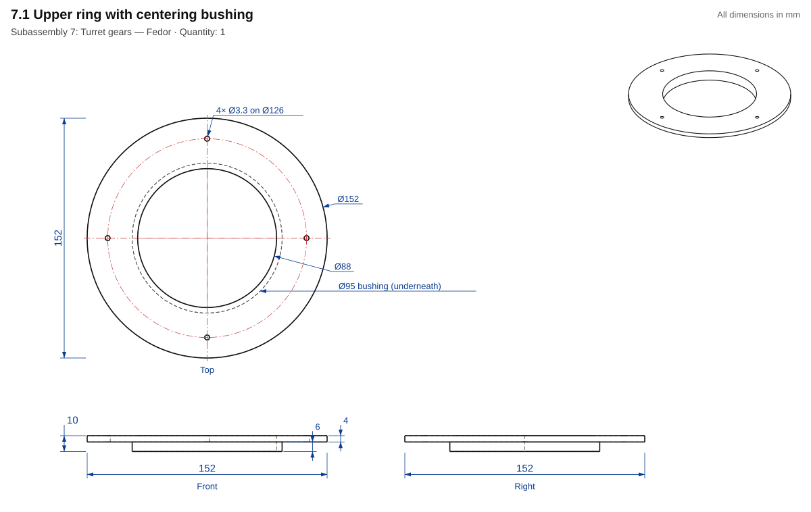
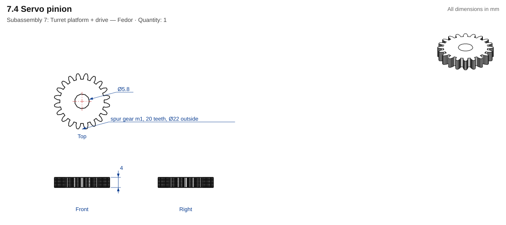

# 7. Turret base

**Student:** Alexey

## Where it goes

{width=60%}

## Assembly

## Parts

| Part | Name | Qty |
|---|---|---|
| [7.1](#p7-1) | Turret post | 4 |
| [7.2](#p7-2) | Lower bearing ring | 1 |
| [7.3](#p7-3) | Servo tower | 1 |
| [7.4](#p7-4) | Turret servo (standard servo) | 1 |

### 7.1 Turret post {#p7-1}

### 7.2 Lower bearing ring {#p7-2}

### 7.3 Servo tower {#p7-3}

### 7.4 Turret servo (standard servo) {#p7-4}

