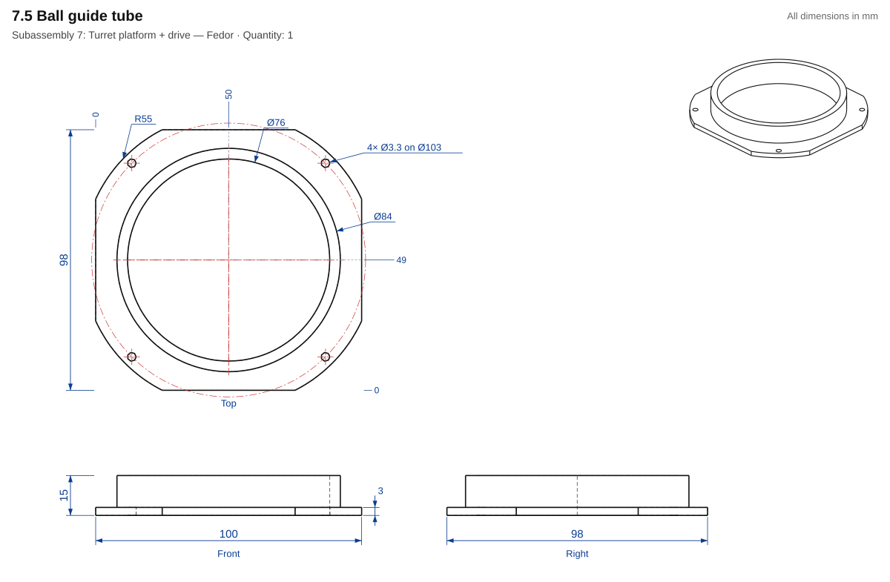
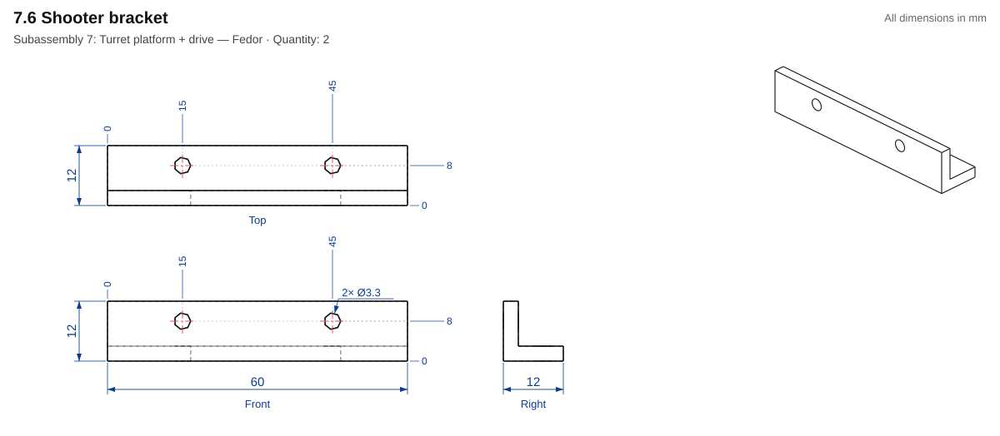

# 7. Turret platform + drive

**Student:** Fedor

## Where it goes

{width=60%}

## Assembly

## Parts

| Part | Name | Qty |
|---|---|---|
| [7.1](#p7-1) | Turret platform | 1 |
| [7.2](#p7-2) | Upper bearing ring | 1 |
| [7.3](#p7-3) | Turret gear | 1 |
| [7.4](#p7-4) | Servo pinion | 1 |
| [7.5](#p7-5) | Ball guide tube | 1 |
| [7.6](#p7-6) | Shooter bracket | 2 |

### 7.1 Turret platform {#p7-1}

### 7.2 Upper bearing ring {#p7-2}

### 7.3 Turret gear {#p7-3}

### 7.4 Servo pinion {#p7-4}

### 7.5 Ball guide tube {#p7-5}

### 7.6 Shooter bracket {#p7-6}

