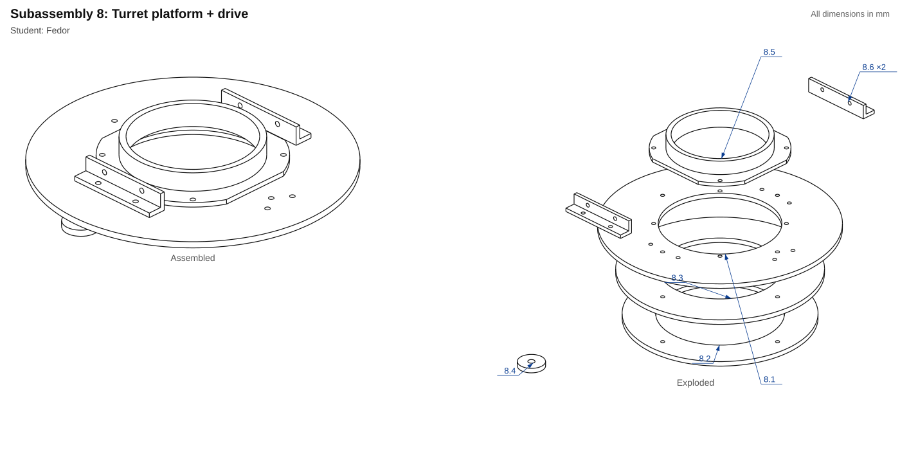

# 8. Shooter

**Student:** Andrey

## Where it goes

{width=60%}

## Assembly

## Parts

| Part | Name | Qty |
|---|---|---|
| [8.1](#p8-1) | Shooter plate, motor side | 1 |
| [8.2](#p8-2) | Shooter plate, free side | 1 |
| [8.3](#p8-3) | Flywheel | 1 |
| [8.4](#p8-4) | Flywheel shaft | 1 |
| [8.5](#p8-5) | Shaft coupler | 1 |
| [8.6](#p8-6) | Shooter motor (standard motor) | 1 |

### 8.1 Shooter plate, motor side {#p8-1}

### 8.2 Shooter plate, free side {#p8-2}

### 8.3 Flywheel {#p8-3}

### 8.4 Flywheel shaft {#p8-4}

### 8.5 Shaft coupler {#p8-5}

### 8.6 Shooter motor (standard motor) {#p8-6}

