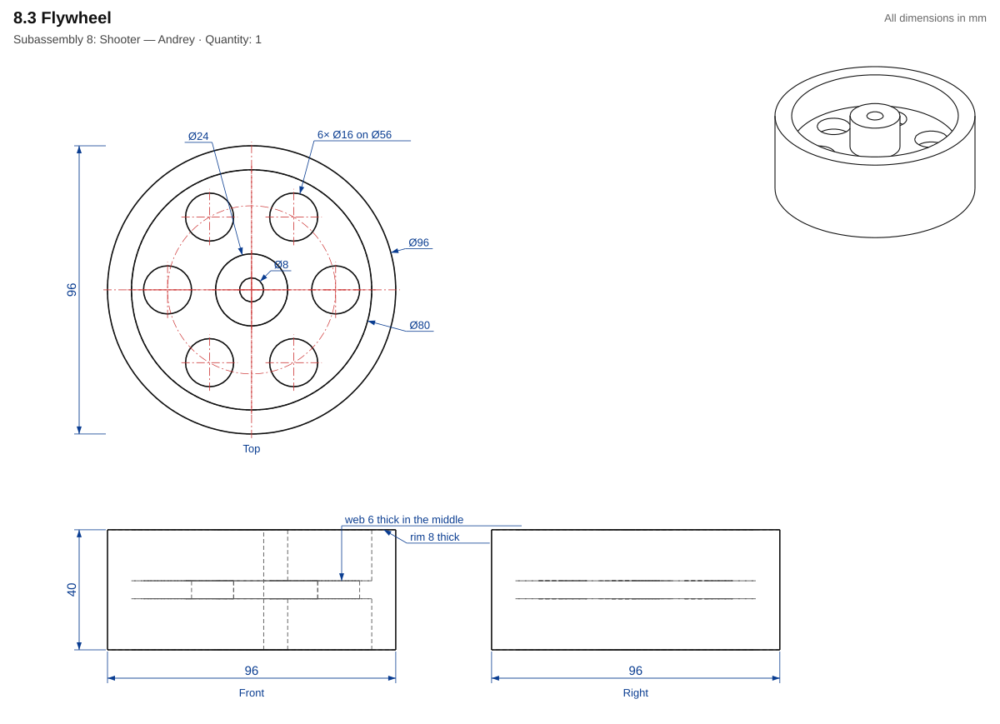

# 8. Turret platform

**Student:** Egor

## Where it goes

{width=60%}

## Assembly

## Parts

| Part | Name | Qty |
|---|---|---|
| [8.1](#p8-1) | Turret platform | 1 |
| [8.2](#p8-2) | Ball guide tube | 1 |
| [8.3](#p8-3) | Shooter bracket | 2 |

### 8.1 Turret platform {#p8-1}

### 8.2 Ball guide tube {#p8-2}

### 8.3 Shooter bracket {#p8-3}

