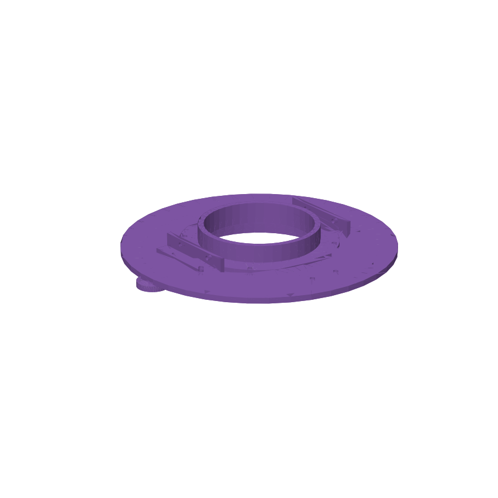
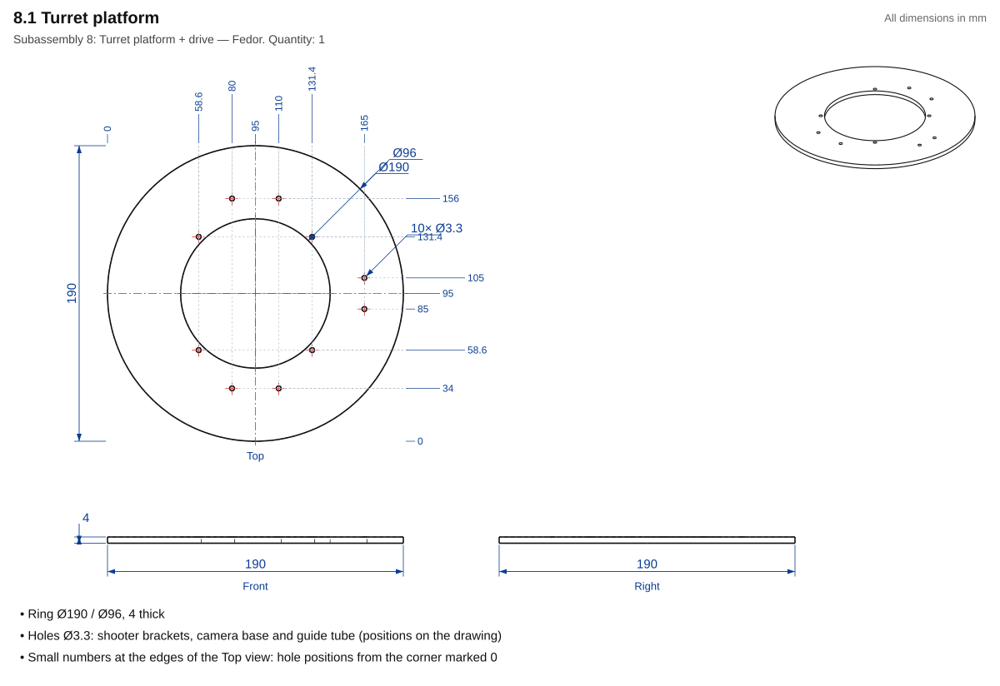
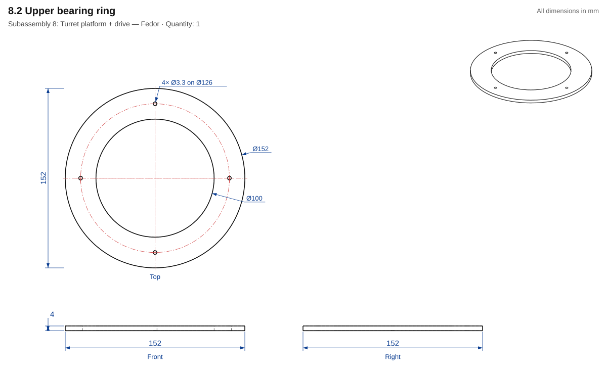
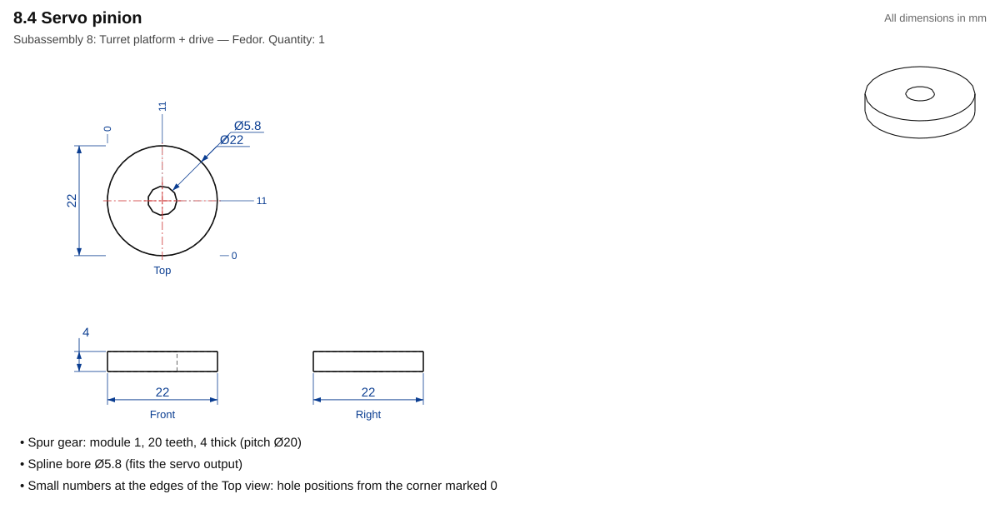
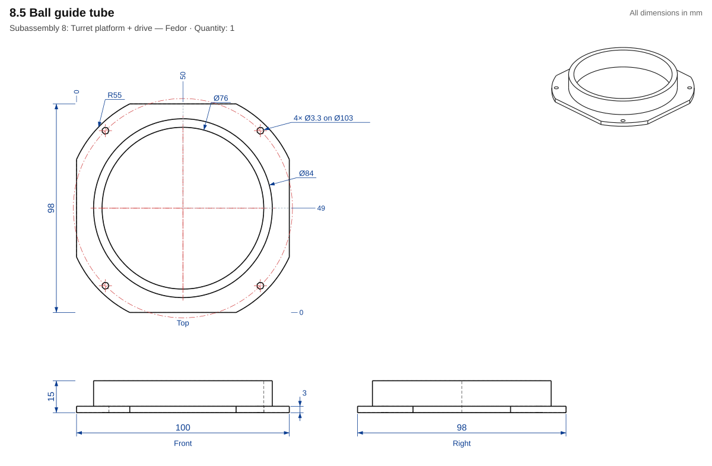
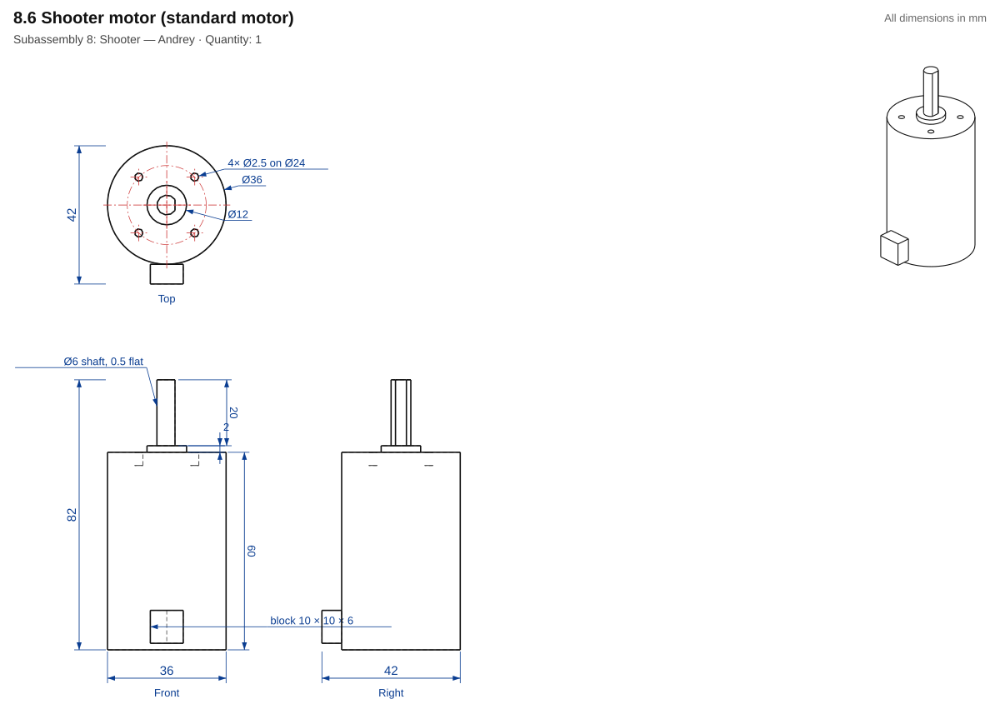

# 8. Turret platform + drive

**Student:** Fedor

{width=60%}

| Part | Name | Qty |
|---|---|---|
| [8.1](#p8-1) | Turret platform | 1 |
| [8.2](#p8-2) | Upper bearing ring | 1 |
| [8.3](#p8-3) | Turret gear | 1 |
| [8.4](#p8-4) | Servo pinion | 1 |
| [8.5](#p8-5) | Ball guide tube | 1 |
| [8.6](#p8-6) | Shooter bracket | 2 |

## 8.1 Turret platform {#p8-1}

## 8.2 Upper bearing ring {#p8-2}

## 8.3 Turret gear {#p8-3}

## 8.4 Servo pinion {#p8-4}

## 8.5 Ball guide tube {#p8-5}

## 8.6 Shooter bracket {#p8-6}

