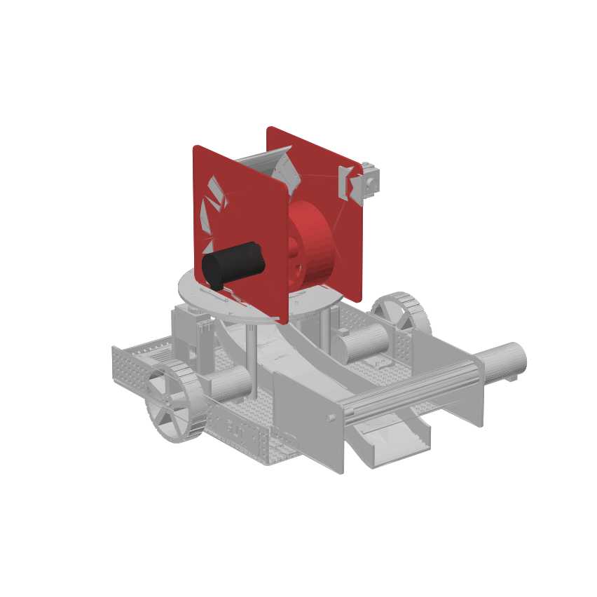
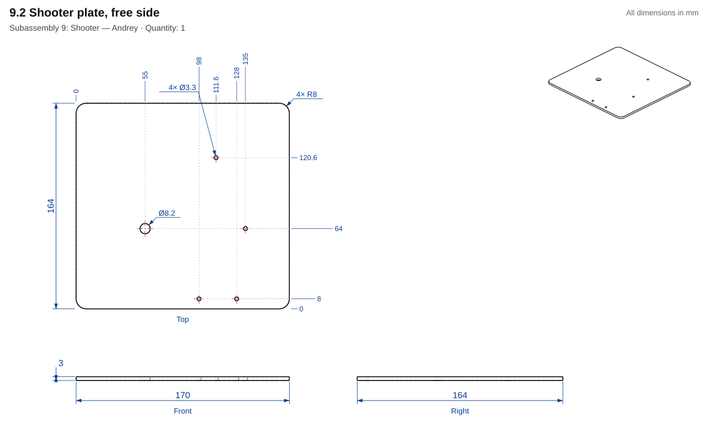
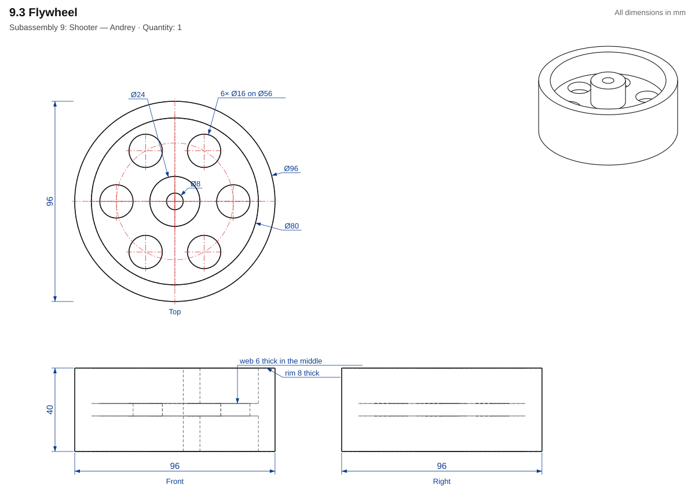
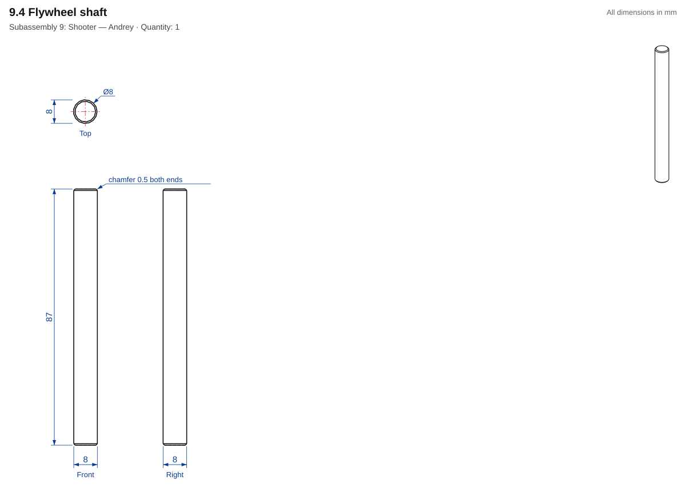
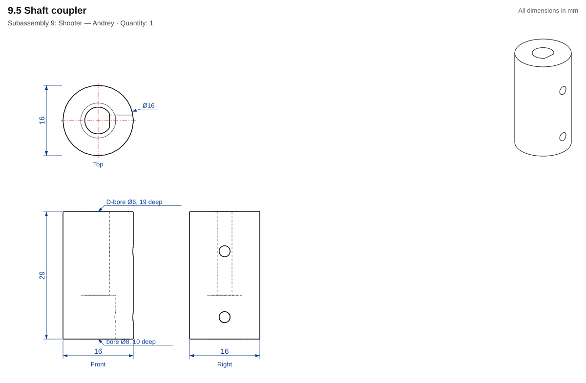
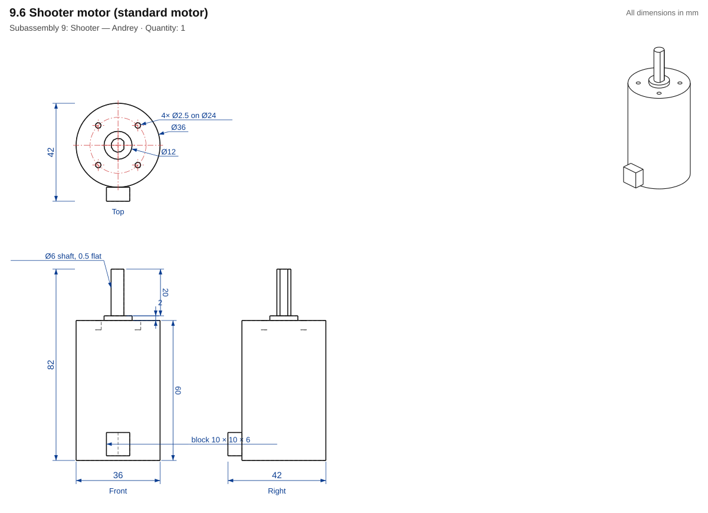

# 9. Shooter

**Student:** Andrey

## Where it goes

{width=60%}

## Assembly

## Parts

| Part | Name | Qty |
|---|---|---|
| [9.1](#p9-1) | Shooter plate, motor side | 1 |
| [9.2](#p9-2) | Shooter plate, free side | 1 |
| [9.3](#p9-3) | Flywheel | 1 |
| [9.4](#p9-4) | Flywheel shaft | 1 |
| [9.5](#p9-5) | Shaft coupler | 1 |
| [9.6](#p9-6) | Shooter motor (standard motor) | 1 |

### 9.1 Shooter plate, motor side {#p9-1}

### 9.2 Shooter plate, free side {#p9-2}

### 9.3 Flywheel {#p9-3}

### 9.4 Flywheel shaft {#p9-4}

### 9.5 Shaft coupler {#p9-5}

### 9.6 Shooter motor (standard motor) {#p9-6}

