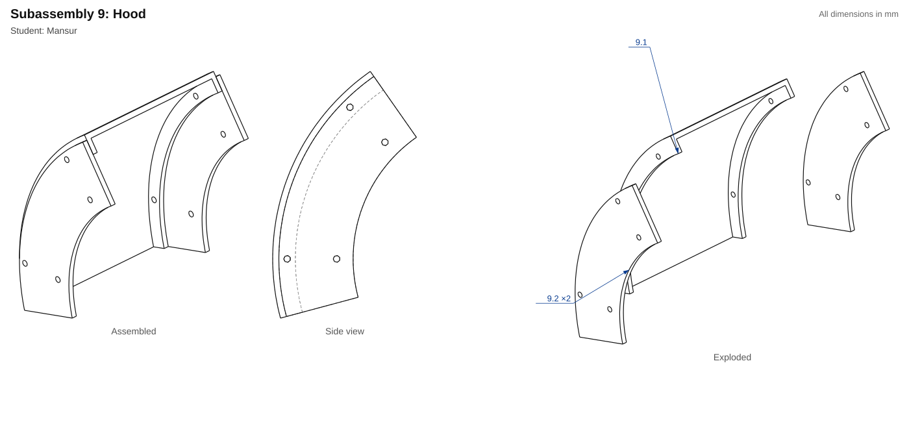
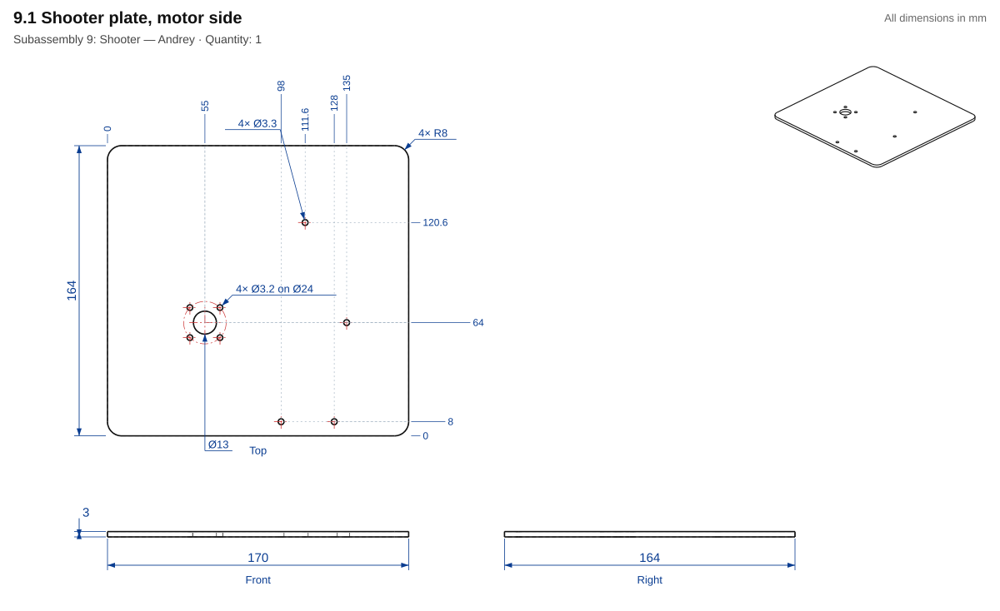

# 9. Hood

**Student:** Mansur

## Where it goes

{width=60%}

## Assembly

## Parts

| Part | Name | Qty |
|---|---|---|
| [9.1](#p9-1) | Hood | 1 |
| [9.2](#p9-2) | Hood bracket | 2 |

### 9.1 Hood {#p9-1}

### 9.2 Hood bracket {#p9-2}

